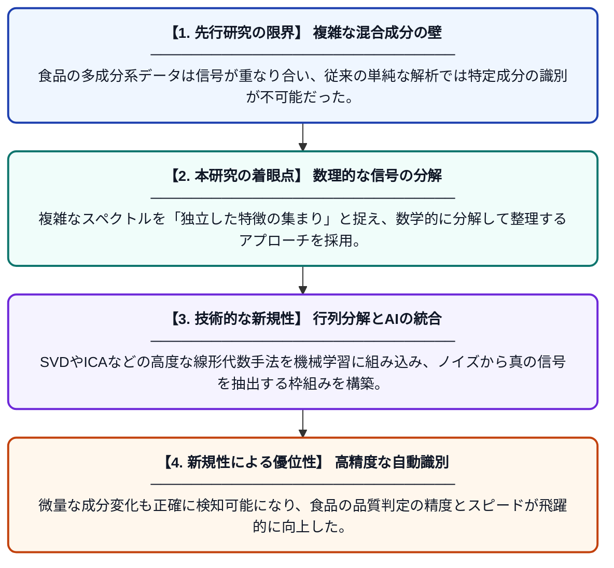

# 食品分析におけるラマン分光法と機械学習を融合させた研究の進展、主要な課題、および将来の展望

**Original Title**: *Research Progress, Key Challenges, and Future Prospects of Raman Spectroscopy Combined With Machine Learning in Food Analysis*

> **💡 一言要約**: ラマン分光とAIの融合で食品の「中身」を瞬時に見抜く

| 項目 | 内容 |
|---|---|
| **著者** | C Chen, F Guo, J Wang, S Gao, X Jing, M Jiang, Z Xu… |
| **掲載誌** | Comprehensive Reviews in … 2026 |
| **アラートキーワード** | independent component ... |
| **原文リンク** | [https://ift.onlinelibrary.wiley.com/doi/abs/10.1111/1541-4337.70688](https://ift.onlinelibrary.wiley.com/doi/abs/10.1111/1541-4337.70688) |
| **PDF版要約** | [README.pdf](./README.pdf) |

---

## 📊 新規性の図解（先行研究との違いと本研究のブレークスルー）

## 📝 要約

食品の品質管理や安全性評価において、ラマン分光スペクトルと機械学習を組み合わせた最新の解析手法を包括的にレビューした論文です。線形代数的な手法（SVDやICAなど）を用いて複雑な混合信号から独立した特徴を抽出する技術を中心に、現在の技術的課題と今後の発展の方向性を論じています。

## ❓ どんな問題に取り組んだか

食品は多種多様な成分が混ざり合っているため、得られる分光データが極めて複雑になり、特定の成分を正確に識別することが困難でした。また、ノイズの多いデータからいかに効率的かつ高精度に情報を抽出するかという解析手法の確立が大きな課題となっていました。

## ✨ 何が新しい？何がすごい？（新規性）

本論文は、固有値分解、特異値分解（SVD）、独立成分分析（ICA）といった線形代数の高度なアルゴリズムを機械学習に統合し、複雑な混合スペクトルを独立した特徴成分へと分解する手法を体系化しました。食品分析に特化したデータ処理の最適化戦略を整理し、従来の研究では不十分だった「複雑な背景ノイズ下での高精度な成分特定」への道筋を示した点が大きな貢献です。単なる手法紹介にとどまらず、実用化に向けた技術的なボトルネックを明確に定義しています。

## 🎓 大学1年生向けの解説

「ラマン分光法」とは、光を物質に当てたときの反射を調べることで、その物質が何でできているかを非破壊で特定する魔法のような技術です。しかし、食品は色々な成分が混ざっているため、データが複雑な「ごちゃ混ぜ」状態になり、解析が大変でした。この研究では、AI（機械学習）と数学的な工夫を使って、そのごちゃ混ぜのデータから必要な情報だけをきれいに取り出す方法をまとめています。これにより、食品の産地偽装や毒物の混入などを、一瞬で見抜ける未来を目指しています。
