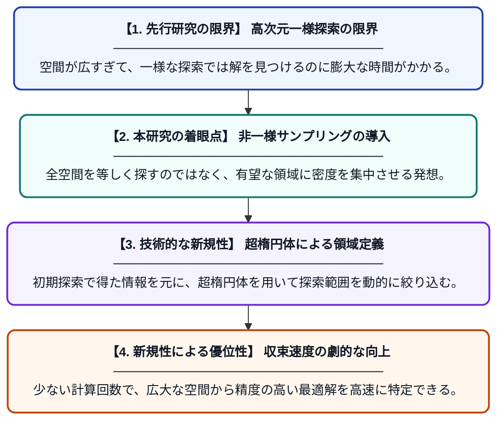

# 超楕円体密度サンプリング：高次元数値最適化を加速する探索的シーケンス

**Original Title**: *Hyperellipsoid Density Sampling: Exploitative Sequences to Accelerate High-Dimensional Numerical Optimization*

> **💡 一言要約**: 超楕円体で狙い撃ち、高次元最適化を高速化

| 項目 | 内容 |
|---|---|
| **著者** | JG Soltes |
| **掲載誌** | arXiv preprint arXiv:2511.07836 2026 |
| **アラートキーワード** | optimization |
| **PDF** | [https://www.researchgate.net/profile/Julian-Soltes/publication/397521973_Hyperellipsoid_Density_Sampling_Exploitative_Sequences_to_Accelerate_High-Dimensional_Optimization/links/6a7bdddab2a395435d0b6b31/Hyperellipsoid-Density-Sampling-Exploitative-Sequences-to-Accelerate-High-Dimensional-Optimization.pdf](https://www.researchgate.net/profile/Julian-Soltes/publication/397521973_Hyperellipsoid_Density_Sampling_Exploitative_Sequences_to_Accelerate_High-Dimensional_Optimization/links/6a7bdddab2a395435d0b6b31/Hyperellipsoid-Density-Sampling-Exploitative-Sequences-to-Accelerate-High-Dimensional-Optimization.pdf) |
| **原文リンク** | [https://www.researchgate.net/profile/Julian-Soltes/publication/397521973_Hyperellipsoid_Density_Sampling_Exploitative_Sequences_to_Accelerate_High-Dimensional_Optimization/links/6a7bdddab2a395435d0b6b31/Hyperellipsoid-Density-Sampling-Exploitative-Sequences-to-Accelerate-High-Dimensional-Optimization.pdf](https://www.researchgate.net/profile/Julian-Soltes/publication/397521973_Hyperellipsoid_Density_Sampling_Exploitative_Sequences_to_Accelerate_High-Dimensional_Optimization/links/6a7bdddab2a395435d0b6b31/Hyperellipsoid-Density-Sampling-Exploitative-Sequences-to-Accelerate-High-Dimensional-Optimization.pdf) |
| **PDF版要約** | [README.pdf](./README.pdf) |

---

## 📊 新規性の図解（先行研究との違いと本研究のブレークスルー）

## 📝 要約

高次元空間における数値最適化を高速化するため、非一様なサンプリング戦略である「超楕円体密度サンプリング」を提案しています。一様分布による初期探索の後に、有望な領域へサンプルを集中させるハイブリッドな手法により、探索効率を劇的に向上させています。

## ❓ どんな問題に取り組んだか

高次元の数値最適化において、探索空間が膨大になると一様なサンプリングでは解の収束に膨大な時間がかかるという課題があります。従来のランダムな探索手法では、有望な領域を特定して集中的に深掘りする「探索的（Exploitative）」な動作が不足していました。

## ✨ 何が新しい？何がすごい？（新規性）

本研究の最大の特徴は、探索空間内の有望な領域を超楕円体として定義し、その内部で密度の高い非一様サンプリングを行う新しいシーケンスを導入した点です。先行研究が主に空間全体の一様性に拘泥していたのに対し、本手法は初期探索の結果を活かして動的にサンプリング密度を変化させるハイブリッド戦略を採用しています。これにより、計算リソースを最適解の周辺に集中させ、高次元問題での収束速度を大幅に引き上げることに成功しました。

## 🎓 大学1年生向けの解説

広い砂漠で落とし物を探すとき、闇雲に歩き回る（一様サンプリング）のは効率が悪いです。この研究では、まず軽く全体を調べて「怪しい場所」を見つけたら、そこを楕円のような形で囲い、その中を重点的に調べる方法を編み出しました。この「超楕円体」という数学的な枠組みを使うことで、次元が非常に高い複雑な問題でも、驚くほど早く正解にたどり着けるようになります。
