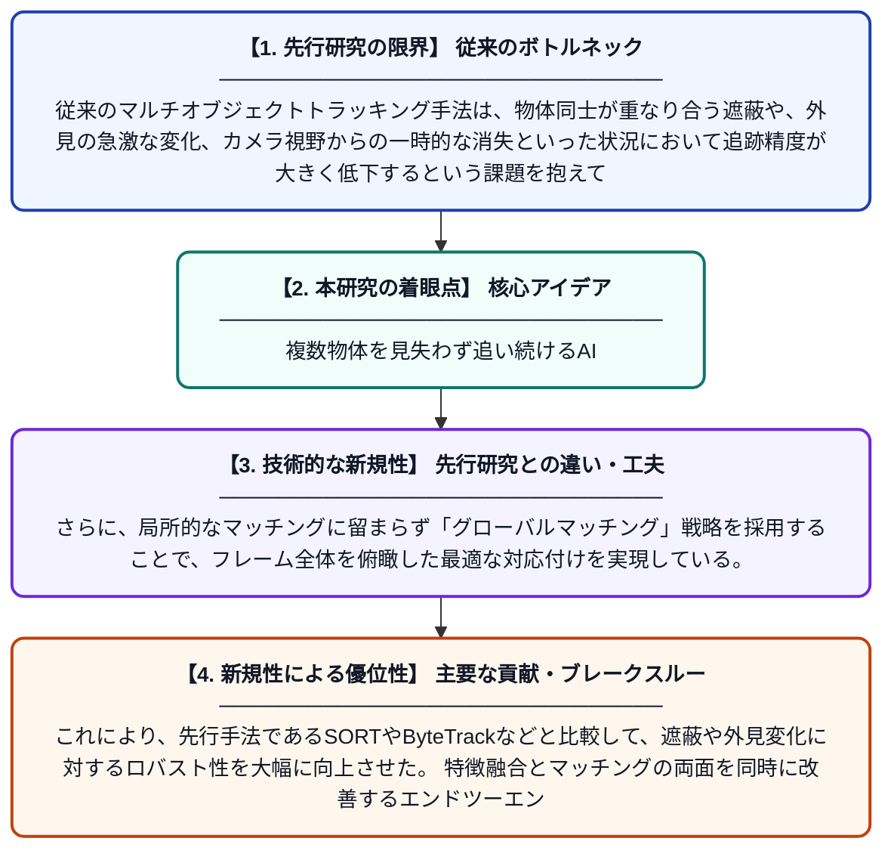

# AFGM-SORT：適応的特徴融合とグローバルマッチングによる頑健な複数物体追跡

**Original Title**: *AFGM-SORT: Adaptive feature fusion and global matching for robust multi-object tracking*

> **💡 一言要約**: 複数物体を見失わず追い続けるAI

| 項目 | 内容 |
|---|---|
| **著者** | F Peng, N Wang, L Wu, Z Peng |
| **掲載誌** | Signal, Image and Video Processing 2026 |
| **アラートキーワード** | Multi Camera Tracking |
| **原文リンク** | [https://link.springer.com/article/10.1007/s11760-026-05539-4](https://link.springer.com/article/10.1007/s11760-026-05539-4) |
| **PDF版要約** | [README.pdf](./README.pdf) |

---

## 📊 新規性の図解（先行研究との違いと本研究のブレークスルー）

## 📝 要約

本論文は、映像中の複数の物体を同時に追跡する「マルチオブジェクトトラッキング（MOT）」の精度向上を目的とした新手法AFGM-SORTを提案している。適応的な特徴融合とグローバルマッチング戦略を組み合わせることで、物体の見た目が変化したり遮蔽が発生したりする困難な状況でも安定した追跡を実現する。既存手法と比較して、追跡の頑健性と精度の両面で顕著な改善を達成している。

## ❓ どんな問題に取り組んだか

従来のマルチオブジェクトトラッキング手法は、物体同士が重なり合う遮蔽や、外見の急激な変化、カメラ視野からの一時的な消失といった状況において追跡精度が大きく低下するという課題を抱えていた。特に、検出と追跡の対応付け（マッチング）が局所的な情報に依存しているため、複雑なシナリオでIDの切り替えや追跡ロストが頻発しやすい問題があった。

## ✨ 何が新しい？何がすごい？（新規性）

本研究は、複数の特徴量を状況に応じて動的に組み合わせる「適応的特徴融合」モジュールを導入し、物体の外見・動き・位置情報を統合的に活用する点が新しい。さらに、局所的なマッチングに留まらず「グローバルマッチング」戦略を採用することで、フレーム全体を俯瞰した最適な対応付けを実現している。これにより、先行手法であるSORTやByteTrackなどと比較して、遮蔽や外見変化に対するロバスト性を大幅に向上させた。特徴融合とマッチングの両面を同時に改善するエンドツーエンドな設計が主要な貢献である。

## 🎓 大学1年生向けの解説

たとえば、街の監視カメラで多くの人が歩き回っているとき、コンピュータが「この人は1番、あの人は2番」と番号を付けながら全員を同時に追い続けるのがマルチオブジェクトトラッキングです。人が重なったり物陰に隠れたりすると、コンピュータは「この人は誰だっけ？」と混乱して番号を間違えてしまうことがあります。この論文では、物体の形・動き・位置など複数の手がかりをうまく組み合わせて使う新しい方法を考え、より広い視野で「誰がどの人か」を判断できるようにしました。その結果、人が隠れても見た目が変わっても、番号を間違えにくい頑健な追跡システムを実現しています。
