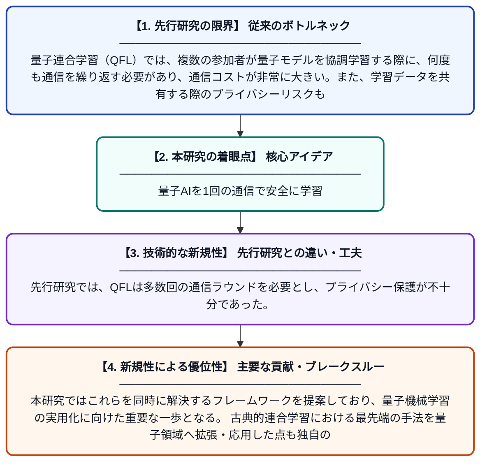

# ワンショット・データフリー量子連合学習

**Original Title**: *One-Shot Data-Free Quantum Federated Learning*

> **💡 一言要約**: 量子AIを1回の通信で安全に学習

| 項目 | 内容 |
|---|---|
| **著者** | Z Wang, X Zhu, B Gu, L Gao, YN Qu |
| **アラートキーワード** | one shot |
| **PDF** | [http://linklings.s3.amazonaws.com/organizations/WCCI/wcci2026/submissions/stype114/5YSEn-ijcnn_pap3041s2.pdf](http://linklings.s3.amazonaws.com/organizations/WCCI/wcci2026/submissions/stype114/5YSEn-ijcnn_pap3041s2.pdf) |
| **原文リンク** | [http://linklings.s3.amazonaws.com/organizations/WCCI/wcci2026/submissions/stype114/5YSEn-ijcnn_pap3041s2.pdf](http://linklings.s3.amazonaws.com/organizations/WCCI/wcci2026/submissions/stype114/5YSEn-ijcnn_pap3041s2.pdf) |
| **PDF版要約** | [README.pdf](./README.pdf) |

---

## 📊 新規性の図解（先行研究との違いと本研究のブレークスルー）

## 📝 要約

本論文は、量子連合学習（QFL）においてプライバシー保護と効率性を同時に高めるため、「ワンショット（通信1回）」かつ「データフリー（生データ不要）」なアプローチを提案している。従来のQFLが抱える通信コストの高さやデータプライバシーのリスクを克服するための新しいフレームワークを構築している。古典的連合学習における最新手法を量子コンピューティングの文脈に適用・発展させた点が主な貢献である。

## ❓ どんな問題に取り組んだか

量子連合学習（QFL）では、複数の参加者が量子モデルを協調学習する際に、何度も通信を繰り返す必要があり、通信コストが非常に大きい。また、学習データを共有する際のプライバシーリスクも深刻な課題となっている。これらの問題が、QFLの実用化を大きく阻んでいる。

## ✨ 何が新しい？何がすごい？（新規性）

本研究は、「ワンショット学習（通信をたった1回に削減）」と「データフリー手法（生データを直接共有せずに学習）」という2つの概念を量子連合学習に初めて組み合わせて適用した点が新しい。先行研究では、QFLは多数回の通信ラウンドを必要とし、プライバシー保護が不十分であった。本研究ではこれらを同時に解決するフレームワークを提案しており、量子機械学習の実用化に向けた重要な一歩となる。古典的連合学習における最先端の手法を量子領域へ拡張・応用した点も独自の貢献である。

## 🎓 大学1年生向けの解説

「連合学習」とは、たくさんの人がそれぞれのデータを直接共有せずに、AIを一緒に賢くする技術です。本研究はこれを「量子コンピュータ」という超高性能なコンピュータで行う方法を考えました。普通は何度もやり取りしないといけないところを、たった1回のやり取りで済むようにしています。さらに、個人の生データを一切外に出さなくても学習できるので、プライバシーも守れます。量子コンピュータ時代の安全で効率的なAI学習の実現を目指した研究です。
