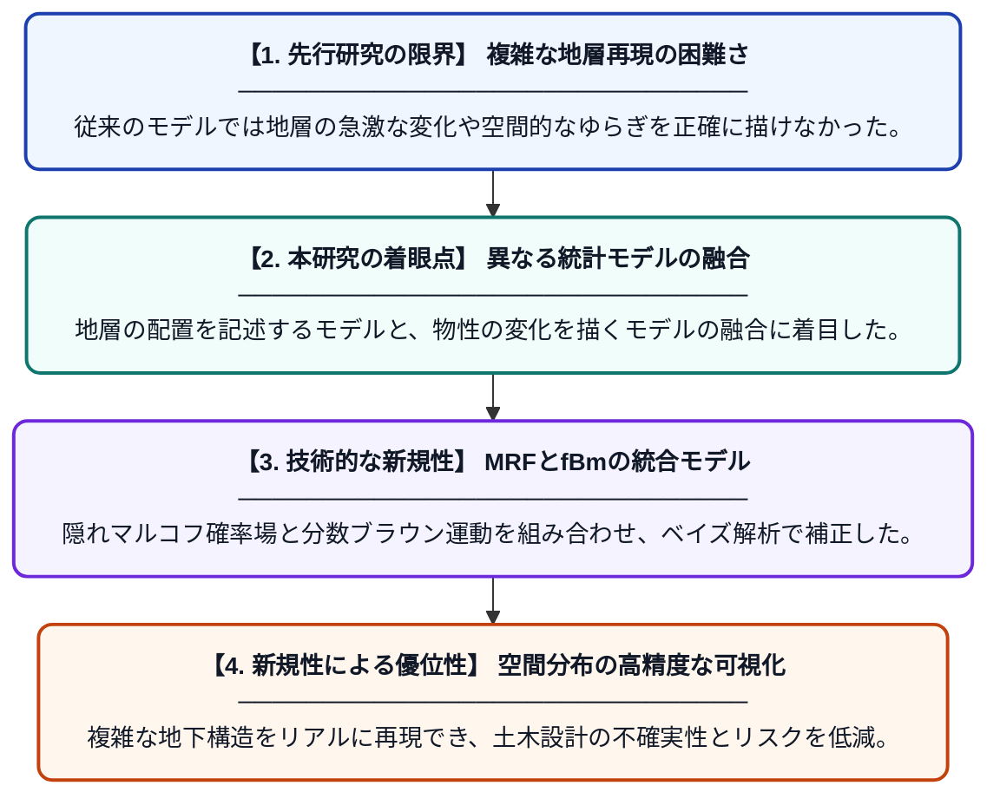

# マルコフ確率場と分数ブラウン運動を用いた3次元地盤物性の推定モデル

**Original Title**: *3D Stratigraphic-based geo-property random field using Markov random fields and the concept of fractional Brownian motion*

> **💡 一言要約**: 地層の不均一性を最新の確率モデルで精密に再現

| 項目 | 内容 |
|---|---|
| **著者** | YC Lu, WY Chien, CH Yeh, SC Nicholas, JJ Dong… |
| **掲載誌** | Georisk: Assessment and … 2026 |
| **アラートキーワード** | MRFs Markov |
| **原文リンク** | [https://www.tandfonline.com/doi/abs/10.1080/17499518.2026.2753465](https://www.tandfonline.com/doi/abs/10.1080/17499518.2026.2753465) |
| **PDF版要約** | [README.pdf](./README.pdf) |

---

## 📊 新規性の図解（先行研究との違いと本研究のブレークスルー）

## 📝 要約

確率的マルコフ確率場、隠れマルコフ確率場、および分数ブラウン運動を統合した新手法「MRF-fBm」を提案する論文です。ベイズ解析を組み合わせることで、3次元的な地層構造に基づいた地盤物性の空間的なばらつきを、限られたデータから高精度に推定することに成功しました。

## ❓ どんな問題に取り組んだか

地盤工学において、地下の土壌特性は場所ごとに複雑に変化するため、限られたボーリング調査から正確な3次元モデルを構築するのは困難でした。従来のランダムフィールド手法では、地層の不連続な境界や、土壌物性が持つ空間的な相関性を十分に再現できないという課題がありました。

## ✨ 何が新しい？何がすごい？（新規性）

本研究は、地層配置を記述するマルコフ確率場（MRF）と、局所的な物性変動を表現する分数ブラウン運動（fBm）を世界で初めて統合した点が画期的です。これにより、地層の「デジタル的な境界」と「アナログ的な物性変化」を同時にモデル化することを可能にしました。さらに、ベイズ解析を導入して観測データに基づいたモデル最適化を行うことで、予測の精度と不確実性の評価を大幅に向上させています。

## 🎓 大学1年生向けの解説

地面の下がどうなっているかを調べるのは非常に難しいですが、この研究は「地下の土の性質がどう広がっているか」をコンピュータで賢く予測する方法を開発しました。たとえるなら、パズルのピースが数枚しかない状態から、数学の力を使って全体の絵をリアルに描き出すような技術です。この方法を使えば、どこにどのような土があるかを精密に予想できるため、地震に強い建物を建てたり、地滑りを防いだりする計画が立てやすくなります。
