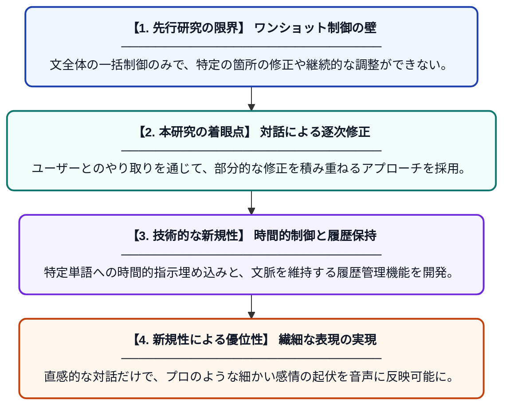

# DialInstruct-TTS: 多対話と微細な時間制御によるインタラクティブな表現力豊かな音声生成

**Original Title**: *DialInstruct-TTS: Interactive Expressive Speech Generation via Multi-Turn Dialogue with Fine-Grained Temporal Control*

> **💡 一言要約**: 対話で声を磨き上げる、次世代の音声合成システム

| 項目 | 内容 |
|---|---|
| **著者** | W Zhou, BT Atmaja, S Sakti |
| **掲載誌** | arXiv preprint arXiv:2611.13875 2026 |
| **アラートキーワード** | one shot |
| **PDF** | [https://arxiv.org/pdf/2611.13875](https://arxiv.org/pdf/2611.13875) |
| **Git リポジトリ** | [https://github.com/FunAudioLLM/CosyVoice](https://github.com/FunAudioLLM/CosyVoice) |
| **原文リンク** | [https://arxiv.org/pdf/2611.13875](https://arxiv.org/pdf/2611.13875) |
| **PDF版要約** | [README.pdf](./README.pdf) |

---

## 📊 新規性の図解（先行研究との違いと本研究のブレークスルー）

## 📝 要約

従来の音声合成システムが抱えていた「一度の指示で文全体を制御する」という制約を打破し、対話を通じて段階的に音声を修正できる「DialInstruct-TTS」を提案しました。特定の単語やフレーズに対して時間軸に沿った詳細な感情調整を可能にし、ユーザーが直感的に理想の音声を追求できる仕組みを実現しています。

## ❓ どんな問題に取り組んだか

従来の命令ベースの音声合成（TTS）は、一回の命令で文全体のスタイルが決定される「ワンショット」形式が主流でした。このため、特定のフレーズだけを微調整したい場合でも、命令文全体を書き直して再生成する必要があり、対話的な修正や局所的な制御が困難でした。

## ✨ 何が新しい？何がすごい？（新規性）

本研究の最大の新規性は、マルチターン対話形式を採用し、過去の修正履歴を保持しながら音声を逐次的に改善できる点にあります。さらに、文全体ではなく特定の時間領域（単語単位など）に対して感情や強弱を指定できる「微細な時間的制御」を導入しました。これにより、先行研究では難しかった「文の途中から徐々に感情を高める」といった繊細な演出が、AIとの対話だけで完結します。

## 🎓 大学1年生向けの解説

AIに喋ってもらうとき、これまでは「一発で完璧な指示」を出す必要がありました。この研究では、AIとチャットをしながら「今の声の、この単語だけもっと明るくして」とか「語尾だけもう少しゆっくり話して」という風に、少しずつ声を直していくことができます。まるで声優さんに演技指導をするように、対話を重ねながら理想の喋り方を作っていける画期的な技術です。
