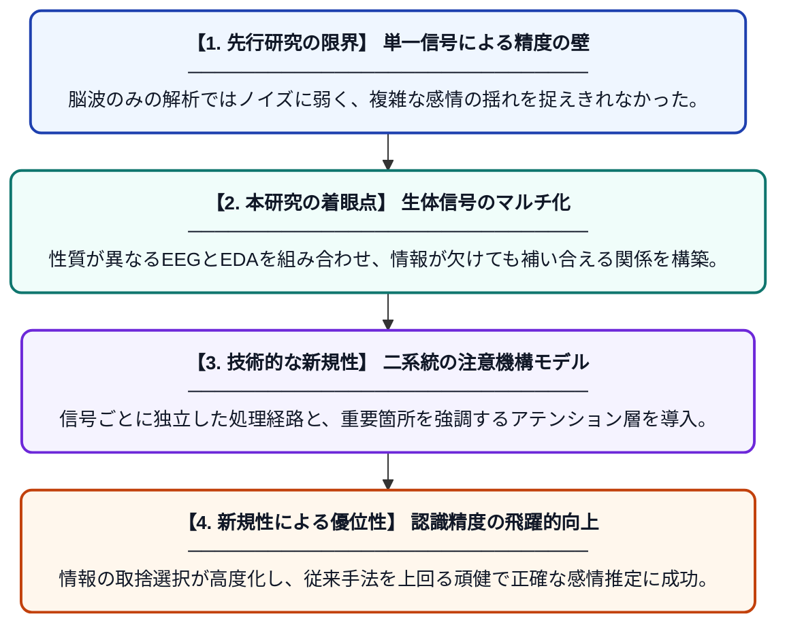

# EEGとEDA信号を用いたマルチモーダル・デュアルストリーム・アテンション・ネットワークによる人間の感情認識

**Original Title**: *Human Emotion Recognition Using Multimodal Dual-Stream Attention Network on EEG and EDA Signals*

> **💡 一言要約**: 脳波と皮膚で感情を読み解く次世代AI

| 項目 | 内容 |
|---|---|
| **著者** | J Vengatachalam, M Ezhilarasan |
| **アラートキーワード** | affective computing |
| **PDF** | [https://www.researchgate.net/profile/Vengatachalam-Jp/publication/417946919_Human_Emotion_Recognition_Using_Multimodal_Dual-_Stream_Attention_Network_on_EEG_and_EDA_Signals/links/6afafa2c3d63ef0688df491a/Human-Emotion-Recognition-Using-Multimodal-Dual-Stream-Attention-Network-on-EEG-and-EDA-Signals.pdf](https://www.researchgate.net/profile/Vengatachalam-Jp/publication/417946919_Human_Emotion_Recognition_Using_Multimodal_Dual-_Stream_Attention_Network_on_EEG_and_EDA_Signals/links/6afafa2c3d63ef0688df491a/Human-Emotion-Recognition-Using-Multimodal-Dual-Stream-Attention-Network-on-EEG-and-EDA-Signals.pdf) |
| **原文リンク** | [https://www.researchgate.net/profile/Vengatachalam-Jp/publication/417946919_Human_Emotion_Recognition_Using_Multimodal_Dual-_Stream_Attention_Network_on_EEG_and_EDA_Signals/links/6afafa2c3d63ef0688df491a/Human-Emotion-Recognition-Using-Multimodal-Dual-Stream-Attention-Network-on-EEG-and-EDA-Signals.pdf](https://www.researchgate.net/profile/Vengatachalam-Jp/publication/417946919_Human_Emotion_Recognition_Using_Multimodal_Dual-_Stream_Attention_Network_on_EEG_and_EDA_Signals/links/6afafa2c3d63ef0688df491a/Human-Emotion-Recognition-Using-Multimodal-Dual-Stream-Attention-Network-on-EEG-and-EDA-Signals.pdf) |
| **PDF版要約** | [README.pdf](./README.pdf) |

---

## 📊 新規性の図解（先行研究との違いと本研究のブレークスルー）

## 📝 要約

脳波（EEG）と皮膚電気活動（EDA）という2種類の生体信号を統合し、注意機構を備えた深層学習モデルで高精度な感情認識を実現する手法を提案しています。複数の異なる生体情報を活用することで、従来の単一の信号を用いた手法よりも、複雑な感情状態をより正確に捉えることが可能になりました。

## ❓ どんな問題に取り組んだか

人間の感情は非常に複雑であり、脳波などの単一の生体信号だけではその全容を正確に把握することが困難でした。また、異なる種類の生体信号をどのように効率よく統合し、ノイズを除去しながら重要な特徴を抽出するかという技術的課題がありました。

## ✨ 何が新しい？何がすごい？（新規性）

本研究の最大の貢献は、EEGとEDAのそれぞれに専用の処理経路を持たせる「デュアルストリーム」構造と、重要なデータに自動で注目する「アテンション機構」を組み合わせた点にあります。単にデータを混ぜるのではなく、各信号から感情に関連する重要な特徴を適応的に重み付けして抽出することで、認識精度を劇的に向上させました。これにより、マルチモーダル（多角的な）なアプローチにおける情報の相互補完を高度に実現しています。

## 🎓 大学1年生向けの解説

私たちが何かを感じたとき、脳の中の電気信号や、手のひらの汗の量（皮膚の電気特性）が微妙に変化します。この研究は、その2つの変化を最新のAIを使って同時に分析することで、「今、その人がどう感じているか」を正確に当てる技術です。AIに「データのどこを重点的に見るべきか」を判断させる仕組みを取り入れたことで、より賢く感情を理解できるようになりました。この技術が進めば、人間の気持ちを察してくれるコンピュータの開発につながります。
