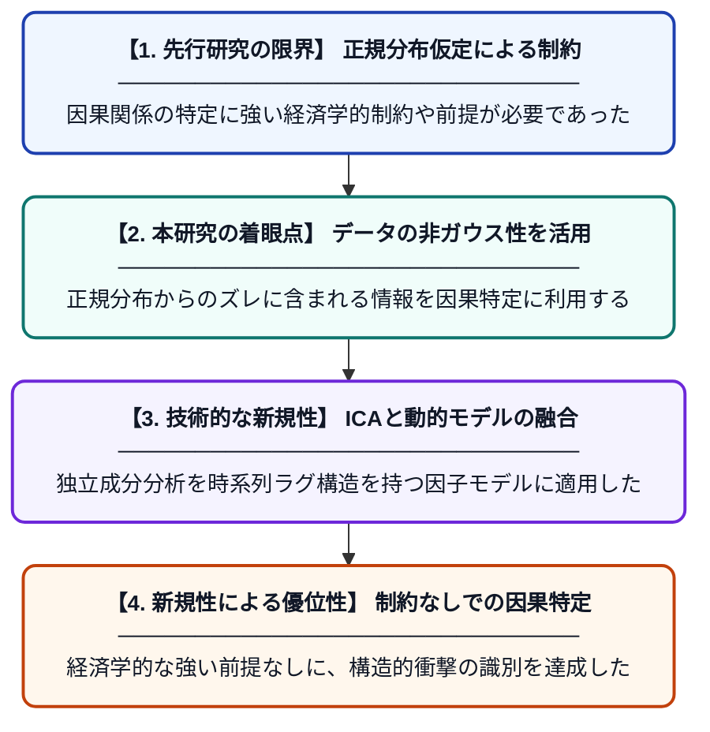

# 非ガウス型構造動的因子モデル：識別と推定

**Original Title**: *Non-Gaussian Structural Dynamic Factor Models: Identification and Estimation*

> **💡 一言要約**: 非ガウス性を武器に経済データの真の要因を特定する

| 項目 | 内容 |
|---|---|
| **著者** | A Kocięcki, C Matthes, M Piffer |
| **アラートキーワード** | independent component ... |
| **PDF** | [https://cm1518.github.io/files/PaperAppendix_v1.10_CM_clean.pdf](https://cm1518.github.io/files/PaperAppendix_v1.10_CM_clean.pdf) |
| **原文リンク** | [https://cm1518.github.io/files/PaperAppendix_v1.10_CM_clean.pdf](https://cm1518.github.io/files/PaperAppendix_v1.10_CM_clean.pdf) |
| **PDF版要約** | [README.pdf](./README.pdf) |

---

## 📊 新規性の図解（先行研究との違いと本研究のブレークスルー）

## 📝 要約

この論文は、経済データの背後にある共通要因を抽出する動的因子モデルにおいて、データの非ガウス性（正規分布に従わない性質）を利用してモデルを識別する新手法を提案しています。独立成分分析（ICA）の考え方を時系列モデルに統合し、従来の手法では困難だった構造的衝撃の特定を可能にしました。

## ❓ どんな問題に取り組んだか

従来の動的因子モデルは、データの分布を正規分布と仮定することが多く、因果関係を特定するために強い経済学的制約を課す必要がありました。しかし、現実の経済データは非ガウス的な性質を持つことが多く、従来手法では真の構造的衝撃を正確に分離できないという課題がありました。

## ✨ 何が新しい？何がすごい？（新規性）

本研究は、独立成分分析（ICA）の枠組みを動的因子モデルに導入し、非ガウス性を利用することで追加の制約なしにモデルを識別できることを理論的に示しました。先行研究が主に静的なモデルを扱っていたのに対し、時系列のラグ構造を含む動的な構造を扱えるように拡張した点が大きな貢献です。さらに、最尤法に基づいた一貫性のある推定アルゴリズムを構築し、実証的な有効性を証明しました。

## 🎓 大学1年生向けの解説

経済のニュースなど、複雑に絡み合ったデータの中から「本当の原因」を見つけ出すのはとても難しいことです。これまでは「データは平均的な形（正規分布）をしている」と決めつけて分析していましたが、この論文はあえて「データの歪みや偏り（非ガウス性）」に注目しました。その歪みをヒントにすることで、今まで見えなかったデータの裏側にある真の因果関係を、特別な仮定なしに計算で導き出せるようにしたのです。
