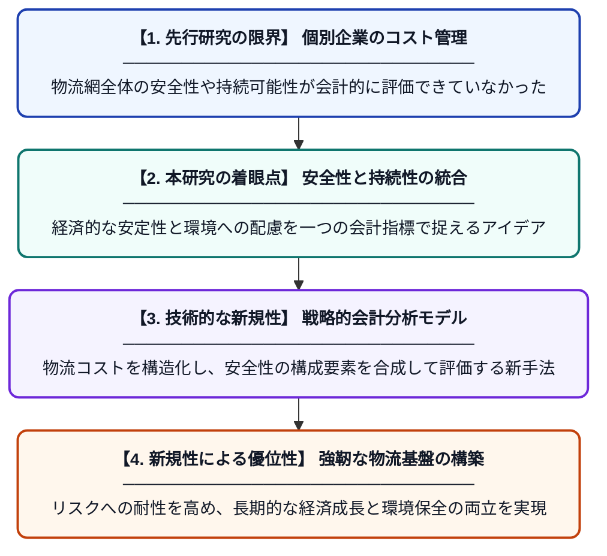

# 持続可能な開発の文脈における物流クラスター形成の戦略的会計と経済的安全性の分析

**Original Title**: *STRATEGIC ACCOUNTING AND ANALYSIS OF ECONOMIC SECURITY OF LOGISTICS CLUSTER FORMATIONS IN THE CONTEXT OF SUSTAINABLE …*

> **💡 一言要約**: 物流網の安全を会計で守り持続可能にする

| 項目 | 内容 |
|---|---|
| **著者** | V Semaniuk, A Papinko |
| **掲載誌** | The Institute of Accounting, Control and Analysis in the … 2026 |
| **アラートキーワード** | logistics |
| **原文リンク** | [https://ibo.wunu.edu.ua/index.php/iboen/article/view/717](https://ibo.wunu.edu.ua/index.php/iboen/article/view/717) |
| **PDF版要約** | [README.pdf](./README.pdf) |

---

## 📊 新規性の図解（先行研究との違いと本研究のブレークスルー）

## 📝 要約

本研究は、持続可能な開発の枠組みにおいて、物流クラスターの経済的安全性を評価するための戦略的会計手法を提案しています。物流コストの構造化と安全性の構成要素を分析することで、クラスター全体が環境変化に耐え、安定した成長を遂げるための理論的根拠を明らかにしました。

## ❓ どんな問題に取り組んだか

従来の会計手法では、複雑に企業が連携する物流クラスター特有のリスクや、持続可能性という新たな要求事項を十分に評価できていませんでした。その結果、経済的な安定性と環境・社会的責任を両立させるための具体的な分析枠組みが不足していることが課題でした。

## ✨ 何が新しい？何がすごい？（新規性）

本研究の新規性は、経済的安全性の概念を持続可能な開発のパラダイムに統合し、物流クラスター専用の戦略的会計フレームワークを構築した点にあります。先行研究が個別のコスト削減に重点を置いていたのに対し、本研究はクラスター全体の相乗効果と外部リスクへの耐性を同時に評価する合成的手法を確立しました。これにより、長期的な視点でのコスト構造化と安全性評価を可能にしたことが最大の貢献です。

## 🎓 大学1年生向けの解説

この研究は、たくさんの会社が協力して荷物を運ぶ「物流グループ」が、将来にわたって潰れずに、かつ地球にも優しく活動し続けるための「健康診断」のような仕組みを作ったものです。単にお金の計算をするだけでなく、どうすれば将来のピンチを乗り越えられるかをデータで分析します。これを使うことで、無駄なコストを減らしながら、環境を守りつつ安定して荷物を届ける強い組織を作ることができます。
