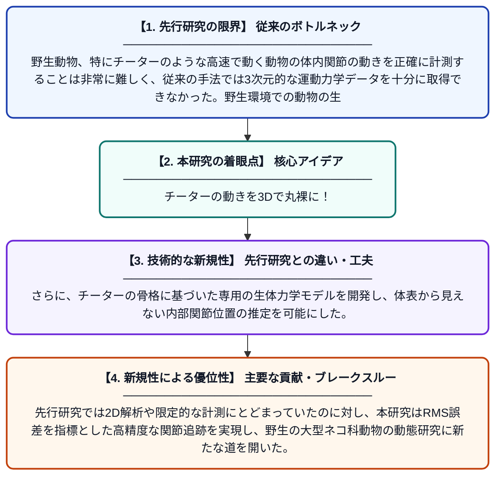

# 野生チーターの動態推定に向けて

**Original Title**: *Towards estimating the dynamics of cheetahs in the wild*

> **💡 一言要約**: チーターの動きを3Dで丸裸に！

| 項目 | 内容 |
|---|---|
| **著者** | Z Parkar |
| **掲載誌** | 2026 |
| **アラートキーワード** | Multi Camera Tracking |
| **原文リンク** | [https://open.uct.ac.za/items/41677483-baf6-4715-8d72-84be1f9b0c1c](https://open.uct.ac.za/items/41677483-baf6-4715-8d72-84be1f9b0c1c) |
| **PDF版要約** | [README.pdf](./README.pdf) |

---

## 📊 新規性の図解（先行研究との違いと本研究のブレークスルー）

## 📝 要約

複数カメラを用いたフォトグラメトリーシステムでチーターの走行・歩行映像を3D計測し、体内の関節位置を追跡するモデルを構築した。このアプローチにより、高精度なマーカー追跡（RMS誤差を最小化）を実現し、野生動物の運動力学の定量的解析に向けた基盤を築いた。

## ❓ どんな問題に取り組んだか

野生動物、特にチーターのような高速で動く動物の体内関節の動きを正確に計測することは非常に難しく、従来の手法では3次元的な運動力学データを十分に取得できなかった。野生環境での動物の生体力学的データの不足は、保全研究や生物工学への応用を妨げてきた。

## ✨ 何が新しい？何がすごい？（新規性）

本研究は、複数カメラによるフォトグラメトリーセットアップを用いてチーターの運動を3D空間で捉えるという新しいアプローチを採用した。さらに、チーターの骨格に基づいた専用の生体力学モデルを開発し、体表から見えない内部関節位置の推定を可能にした。先行研究では2D解析や限定的な計測にとどまっていたのに対し、本研究はRMS誤差を指標とした高精度な関節追跡を実現し、野生の大型ネコ科動物の動態研究に新たな道を開いた。

## 🎓 大学1年生向けの解説

チーターは地上最速の動物ですが、その走り方の詳細な仕組みはまだよくわかっていません。この研究では、複数のカメラを使ってチーターの動きを立体的（3D）に撮影し、体の内側の関節がどう動いているかをコンピュータで計算しました。まるでモーションキャプチャーで映画のCGキャラクターを作るように、チーターの骨格モデルを作って動きを再現したのです。これによって、チーターが走るときに体のどこにどれだけ力がかかっているかを推定できるようになります。将来的には、チーターの保護や、速く走るロボットの設計にも役立てられる研究です。
