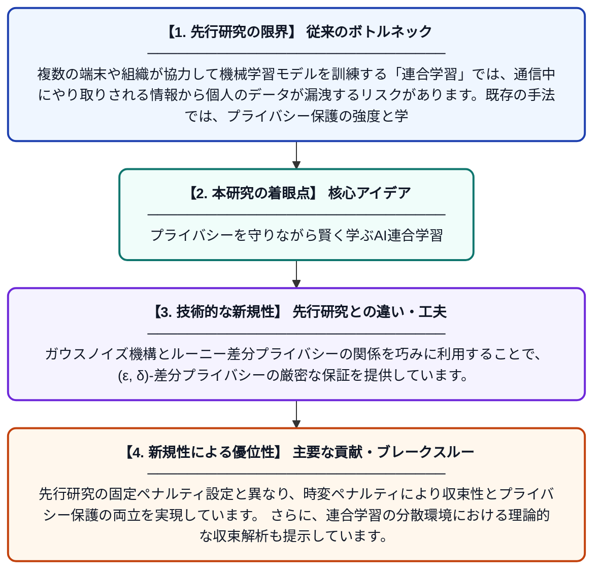

# DP-SPADMM：連合学習のための差分プライバシー対称近接ADMM

**Original Title**: *DP-SPADMM: Differential Privacy Symmetric Proximal ADMM for Federated Learning*

> **💡 一言要約**: プライバシーを守りながら賢く学ぶAI連合学習

| 項目 | 内容 |
|---|---|
| **著者** | K Yang, Y Dang |
| **掲載誌** | Asia-Pacific Journal of Operational Research 2026 |
| **アラートキーワード** | differential privacy |
| **原文リンク** | [https://www.worldscientific.com/doi/abs/10.1142/S0217595926500338](https://www.worldscientific.com/doi/abs/10.1142/S0217595926500338) |
| **PDF版要約** | [README.pdf](./README.pdf) |

---

## 📊 新規性の図解（先行研究との違いと本研究のブレークスルー）

## 📝 要約

本論文では、連合学習における差分プライバシーを保証するための新しいアルゴリズム「DP-SPADMM」を提案しています。時変ペナルティパラメータとガウス機構を組み合わせることで、各クライアントの(ε, δ)-差分プライバシーを実現しています。ルーニー差分プライバシーとの関係を活用し、プライバシー保護と学習精度のバランスを理論的に解析しています。

## ❓ どんな問題に取り組んだか

複数の端末や組織が協力して機械学習モデルを訓練する「連合学習」では、通信中にやり取りされる情報から個人のデータが漏洩するリスクがあります。既存の手法では、プライバシー保護の強度と学習の精度・収束性のトレードオフを十分に解決できていませんでした。特に、ADMMベースの最適化手法に差分プライバシーを効果的に組み込む枠組みが不足していました。

## ✨ 何が新しい？何がすごい？（新規性）

本研究は、ADMMの対称近接バージョン（SPADMM）に時変ペナルティパラメータを導入し、差分プライバシーを組み込んだDP-SPADMMという新しいアルゴリズムを提案した点が独自です。ガウスノイズ機構とルーニー差分プライバシーの関係を巧みに利用することで、(ε, δ)-差分プライバシーの厳密な保証を提供しています。先行研究の固定ペナルティ設定と異なり、時変ペナルティにより収束性とプライバシー保護の両立を実現しています。さらに、連合学習の分散環境における理論的な収束解析も提示しています。

## 🎓 大学1年生向けの解説

「連合学習」とは、スマートフォンや病院などの複数の端末がそれぞれのデータを外部に渡さずに、協力してAIを学習させる仕組みです。しかし、学習中にやり取りするデータからプライバシーが漏れる危険があります。この論文では、「差分プライバシー」という技術を使ってデータに意図的にノイズを加えることで、個人情報を守りながらAIをうまく学習させる新しい方法を開発しました。さらに、時間によってパラメータを変化させる工夫で、プライバシーを守りつつ学習の精度も高く保つことに成功しています。
