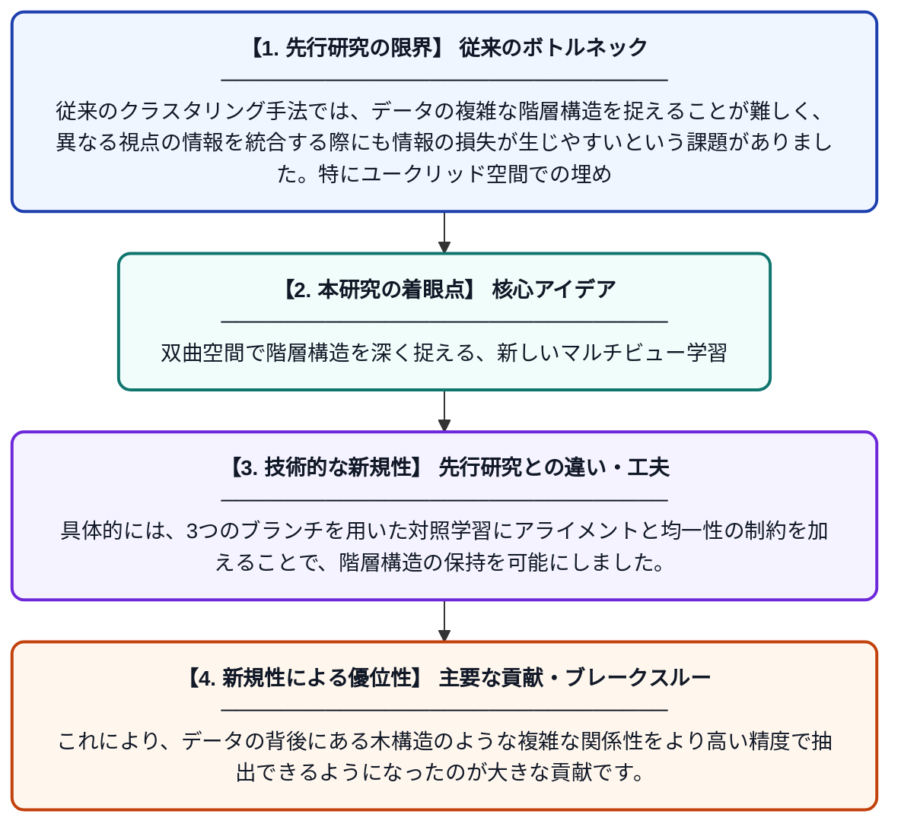

# 融合マルチビュー階層クラスタリングのための双曲埋め込みを用いた対照表現学習

**Original Title**: *Contrastive Representation Learning With Hyperbolic Embedding for Fused Multiview Hierarchical Clustering*

> **💡 一言要約**: 双曲空間で階層構造を深く捉える、新しいマルチビュー学習

| 項目 | 内容 |
|---|---|
| **著者** | Z Li, Z Luo, X Han, N Bouguila, W Su, W Fan |
| **掲載誌** | IEEE Transactions on Neural Networks 2026 |
| **アラートキーワード** | representation learning |
| **原文リンク** | [https://scholar.google.com/scholar_url?url=https://ieeexplore.ieee.org/abstract/document/11744585/&hl=ja&sa=X&d=13553481290190960514&ei=AuLdas6qDMimieoP4sreqQc&scisig=ACTRDVHyACoL_A1dHcQqqAHg801m&oi=scholaralrt&hist=RO4okA8AAAAJ:15402290568201949701:ACTRDVEUaj6DyP4NO0AosE8K3gN9&html=&pos=1&folt=kw-top](https://scholar.google.com/scholar_url?url=https://ieeexplore.ieee.org/abstract/document/11744585/&hl=ja&sa=X&d=13553481290190960514&ei=AuLdas6qDMimieoP4sreqQc&scisig=ACTRDVHyACoL_A1dHcQqqAHg801m&oi=scholaralrt&hist=RO4okA8AAAAJ:15402290568201949701:ACTRDVEUaj6DyP4NO0AosE8K3gN9&html=&pos=1&folt=kw-top) |
| **PDF版要約** | [README.pdf](./README.pdf) |

---

## 📊 新規性の図解（先行研究との違いと本研究のブレークスルー）

## 📝 要約

本論文は、複数の視点（マルチビュー）を持つデータの階層構造を捉えるため、双曲空間での対照学習手法を提案しました。双曲幾何学を用いることでデータの階層的な関係性を効果的に埋め込み、表現学習の精度を向上させています。

## ❓ どんな問題に取り組んだか

従来のクラスタリング手法では、データの複雑な階層構造を捉えることが難しく、異なる視点の情報を統合する際にも情報の損失が生じやすいという課題がありました。特にユークリッド空間での埋め込みは、階層的なデータを表現する際に歪みが生じやすく、構造情報の保持に限界がありました。

## ✨ 何が新しい？何がすごい？（新規性）

本研究の新規性は、双曲空間という特殊な幾何学空間を採用し、対照学習と階層的クラスタリングを統合した点にあります。具体的には、3つのブランチを用いた対照学習にアライメントと均一性の制約を加えることで、階層構造の保持を可能にしました。これにより、データの背後にある木構造のような複雑な関係性をより高い精度で抽出できるようになったのが大きな貢献です。

## 🎓 大学1年生向けの解説

データには木のような階層的な枝分かれ構造が含まれることがよくあります。この研究は、普通の平面的なグラフよりも広い空間を持つ「双曲空間」という数学的な場所でデータを整理する方法を提案しました。これを使うと、バラバラの視点から見たデータをうまくつなぎ合わせて、構造を壊さずに分析できます。例えるなら、地図を広げる時に平面ではなく曲がった紙を使うことで、世界全体のつながりをより正確に描くような工夫です。
