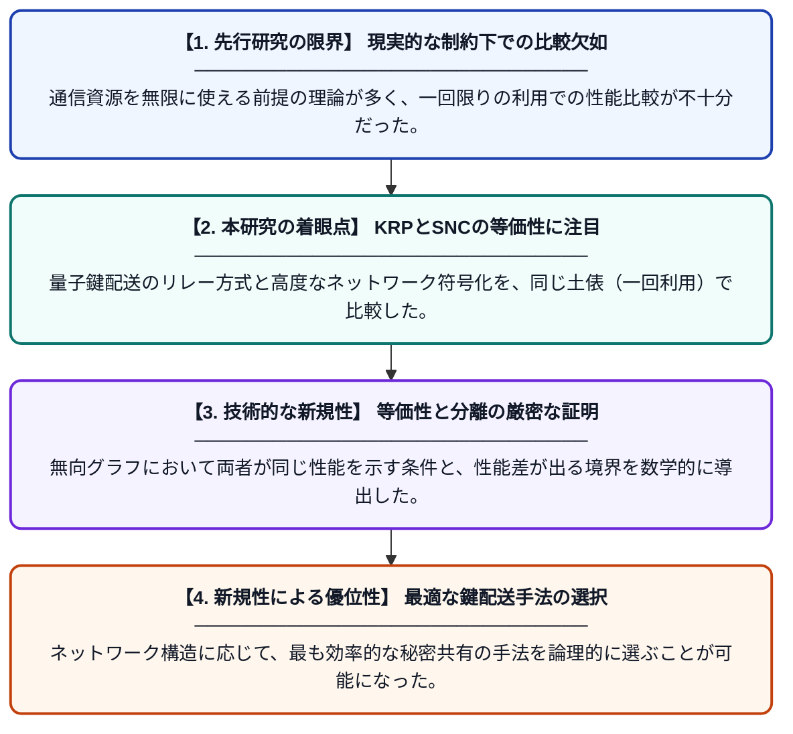

# キーリレーと秘密ネットワークコーディング：無向ネットワークにおけるワンショット等価性と分離

**Original Title**: *Key Relay and Secure Network Coding: One-Shot Equivalence and Separation on Undirected Networks*

> **💡 一言要約**: 量子鍵配送と符号化の境界を数学的に解明

| 項目 | 内容 |
|---|---|
| **著者** | Y Ando, E Chen, G Kato, T Tsurumaru, D Zhang… |
| **掲載誌** | arXiv preprint arXiv … 2026 |
| **アラートキーワード** | one shot |
| **PDF** | [https://arxiv.org/pdf/2611.16776](https://arxiv.org/pdf/2611.16776) |
| **原文リンク** | [https://arxiv.org/pdf/2611.16776](https://arxiv.org/pdf/2611.16776) |
| **PDF版要約** | [README.pdf](./README.pdf) |

---

## 📊 新規性の図解（先行研究との違いと本研究のブレークスルー）

## 📝 要約

量子鍵配送（QKD）に着想を得たキーリレープロトコル（KRP）と秘密ネットワークコーディング（SNC）の性能を、一回限りの通信資源という「ワンショット」設定で比較した研究です。無向グラフネットワークにおいて、これら二つの手法が数学的にいつ等価になり、どのような場合に性能の差（分離）が生じるかを厳密に定義・証明しています。

## ❓ どんな問題に取り組んだか

ネットワーク上で秘密情報を共有する際、鍵をバケツリレー式に送るKRPと、データを演算・加工して送るSNCのどちらが効率的かは長年の課題でした。特に、限られた通信回数と既存の鍵リソースを一度だけ使う「ワンショット」という実用的な制約下での両者の優劣は、これまで理論的に明確にされていませんでした。

## ✨ 何が新しい？何がすごい？（新規性）

本研究は、ワンショット設定においてKRPとSNCが等価になる構造的条件を特定し、無向ネットワークにおける両者の理論的な隔たりを初めて明らかにしました。先行研究では漸近的な（無限回の通信を前提とした）議論が中心でしたが、本研究は「一回の通信資源」という具体的な制約に焦点を当て、数学的な「分離」を証明した点が画期的です。これにより、QKDベースのネットワークにおいてKRPがSNCに対してどの程度の競争力を持つかを定量的に評価可能にしました。

## 🎓 大学1年生向けの解説

インターネットで秘密のメッセージを送るとき、途中の誰かに盗み見られないようにする工夫が必要です。これには「合鍵」をバケツリレーで届ける方法と、データをパズルのように組み合わせて送る方法の2つがあります。この論文は、限られたチャンスでどちらの方法がより効率的に秘密を届けられるかを、数学の力を使って調べました。その結果、ネットワークの形によって、どちらが有利かがはっきりと分かるようになりました。
