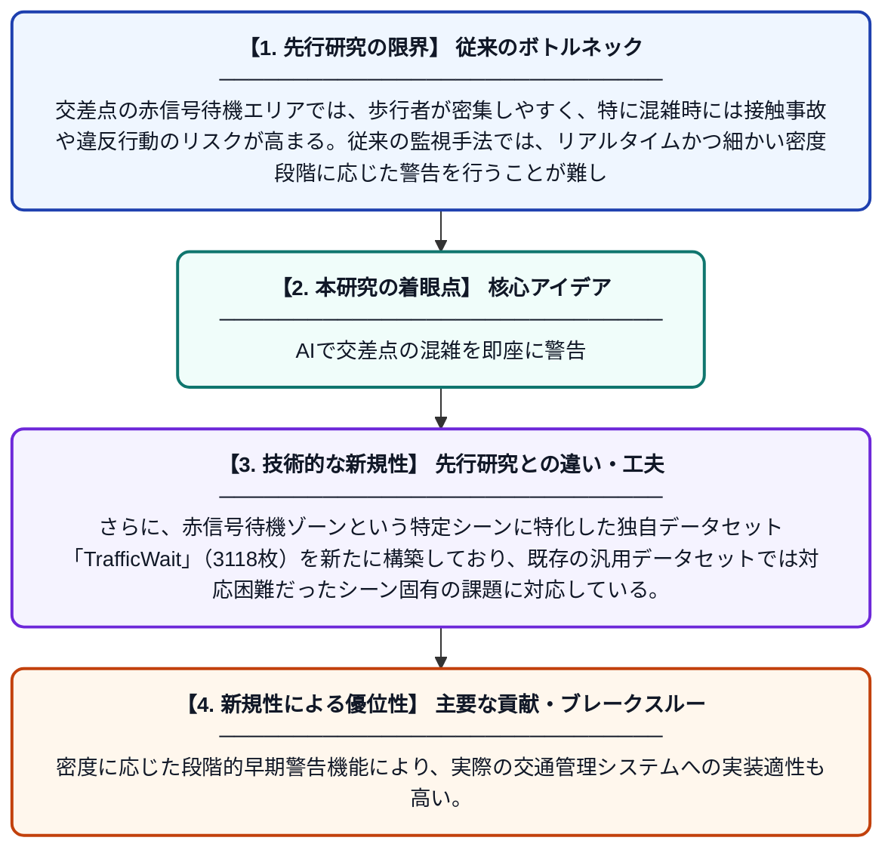

# YOLOv11を用いた赤信号待機ゾーンにおける歩行者密度検出と最適化

**Original Title**: *Pedestrian density detection and optimization in red-light waiting zones based on YOLOv11*

> **💡 一言要約**: AIで交差点の混雑を即座に警告

| 項目 | 内容 |
|---|---|
| **著者** | W Shao, X Hu, Y Xu |
| **掲載誌** | Fifth International Conference on Machine Vision 2026 |
| **アラートキーワード** | kernel density estimation |
| **原文リンク** | [https://www.spiedigitallibrary.org/conference-proceedings-of-spie/14261/1426124/Pedestrian-density-detection-and-optimization-in-red-light-waiting-zones/10.1117/12.3119704.short](https://www.spiedigitallibrary.org/conference-proceedings-of-spie/14261/1426124/Pedestrian-density-detection-and-optimization-in-red-light-waiting-zones/10.1117/12.3119704.short) |
| **PDF版要約** | [README.pdf](./README.pdf) |

---

## 📊 新規性の図解（先行研究との違いと本研究のブレークスルー）

## 📝 要約

本論文では、YOLOv11と領域ガウシアンカーネル密度推定法を組み合わせ、赤信号待機ゾーンにおける歩行者密度をリアルタイムに段階的に警告するシステムを提案している。3118枚のラベル付き画像からなる専用データセット「TrafficWait」を構築し、モデルの学習と評価に活用した。このシステムにより、交差点での歩行者混雑状況の精度の高い把握と安全管理の向上が期待される。

## ❓ どんな問題に取り組んだか

交差点の赤信号待機エリアでは、歩行者が密集しやすく、特に混雑時には接触事故や違反行動のリスクが高まる。従来の監視手法では、リアルタイムかつ細かい密度段階に応じた警告を行うことが難しかった。歩行者専用の交通待機シーンに特化した学習データも不足していた。

## ✨ 何が新しい？何がすごい？（新規性）

最新の物体検出モデルであるYOLOv11に、領域ごとのガウシアンカーネル密度推定を組み合わせることで、単なる人数カウントを超えた「密度の空間分布」を精緻に推定できる点が新しい。さらに、赤信号待機ゾーンという特定シーンに特化した独自データセット「TrafficWait」（3118枚）を新たに構築しており、既存の汎用データセットでは対応困難だったシーン固有の課題に対応している。密度に応じた段階的早期警告機能により、実際の交通管理システムへの実装適性も高い。

## 🎓 大学1年生向けの解説

信号が赤のとき、横断歩道の前で多くの人が待っていますよね。その「待っている人の混み具合」をカメラとAIで自動的に測って、混みすぎたら警告を出す仕組みを作った研究です。AIの中でも最新の『YOLOv11』というモデルを使い、人をすばやく見つけることができます。さらに、どこにどれだけ人が密集しているかを熱分布のように計算する方法も組み合わせています。この研究のために、交差点の待機シーンだけを集めた専用の写真データも3000枚以上新たに用意しました。
