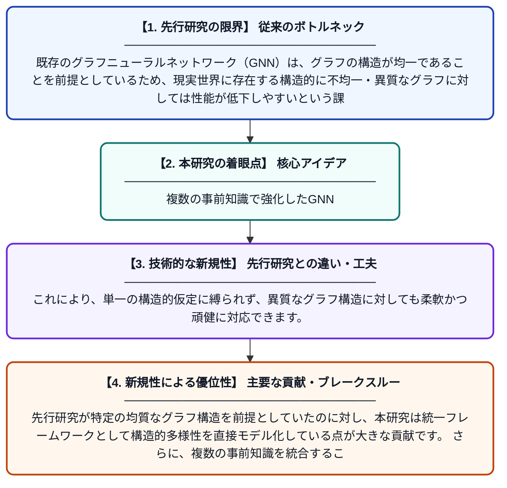

# 頑健で適応的な表現学習のための多重事前情報アンカー付きグラフニューラルネットワーク

**Original Title**: *Multi-prior anchored graph neural networks for robust and adaptive representation learning*

> **💡 一言要約**: 複数の事前知識で強化したGNN

| 項目 | 内容 |
|---|---|
| **著者** | B Xie, Y Wu, J Chen |
| **掲載誌** | International Journal of Machine Learning and Cybernetics 2026 |
| **アラートキーワード** | representation learning |
| **原文リンク** | [https://link.springer.com/article/10.1007/s13042-026-03251-w](https://link.springer.com/article/10.1007/s13042-026-03251-w) |
| **PDF版要約** | [README.pdf](./README.pdf) |

---

## 📊 新規性の図解（先行研究との違いと本研究のブレークスルー）

## 📝 要約

本論文では、構造的に異質なグラフに対して頑健な表現学習を行うための統合フレームワーク「MPA-GNN（多重事前情報アンカー付きグラフニューラルネットワーク）」を提案しています。従来のグラフニューラルネットワークが抱えていた、グラフ構造の多様性やノイズへの脆弱性という問題に対処しています。複数の事前情報をアンカーとして活用することで、より頑健かつ適応的なグラフ表現の学習を実現しています。

## ❓ どんな問題に取り組んだか

既存のグラフニューラルネットワーク（GNN）は、グラフの構造が均一であることを前提としているため、現実世界に存在する構造的に不均一・異質なグラフに対しては性能が低下しやすいという課題があります。また、ノイズやデータの欠損、グラフ構造の不確かさに対する頑健性が不十分であり、多様なドメインへの適応が難しい状況でした。

## ✨ 何が新しい？何がすごい？（新規性）

MPA-GNNは、複数の事前情報（マルチプライア）をアンカーとして導入するという、従来のGNN設計とは一線を画すアプローチを採用しています。これにより、単一の構造的仮定に縛られず、異質なグラフ構造に対しても柔軟かつ頑健に対応できます。先行研究が特定の均質なグラフ構造を前提としていたのに対し、本研究は統一フレームワークとして構造的多様性を直接モデル化している点が大きな貢献です。さらに、複数の事前知識を統合することで表現の質と安定性を同時に向上させた点も新規性として挙げられます。

## 🎓 大学1年生向けの解説

グラフとは、人間関係や交通網のように「点」と「点をつなぐ線」で表されるデータ構造のことです。グラフニューラルネットワーク（GNN）はそのようなグラフデータからパターンを学習するAIですが、現実のグラフはバラバラな構造を持つことが多く、既存のAIはうまく対応できませんでした。この研究では、「複数の事前知識をアンカー（固定点）として使う」という新しいアイデアで、どんな形のグラフでも安定して学習できる仕組みを開発しました。たとえるなら、地図を読むときに複数のランドマークを使って自分の位置を正確に把握するようなイメージです。これにより、AIがより多様な現実問題に対応できるようになります。
