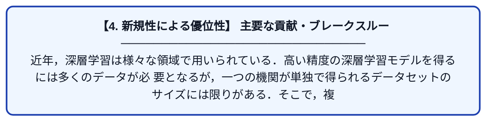

# データの異種性が連合学習モデルの性能に与える影響に関する研究

| 項目 | 内容 |
|---|---|
| **PDF版要約** | [README.pdf](./README.pdf) |

---

## 📊 新規性の図解（先行研究との違いと本研究のブレークスルー）

## 📝 要約

近年，深層学習は様々な領域で用いられている．高い精度の深層学習モデルを得るには多くのデータが必
要となるが，一つの機関が単独で得られるデータセットのサイズには限りがある．そこで，複数の機関がデータを持
ち寄り深層学習を行う連合学習（federated learning）が用いられる．しかし連合学習では，クライアント間のデータ
の分布が不均一である場合に，機械学習モデルの精度が低下してしまう問題がある

水平連合学習 : 同じサンプルを持つが、特徴量が分散している場合

垂直連合学習 :  サンプルが分散している場合。

がある。

水平連合学習のアルゴリズム，
McMahan らによって提案された Federated Averaging (以降，FedAvg とよぶ) アルゴリズム [2] がある．FedAvg アルゴリズムについては，3 章で詳しく述べる．

学習を行なった場合に，モデルの精度が低下することを示している [4]．これは，各クライアントが持つデータの分布が異なるため，ローカルモデルの平均がグローバルモデルと大きく異なることが原因である

文献 [5] は，このような Non-IID データ
へのアプローチとして主に 3 つの方法を挙げている．
• アルゴリズムベースのアプローチ
• システムベースのアプローチ
• データベースのアプローチ

アルゴリズムベースのアプローチとしては，Per-FedAvg [6]がある．Per-FedAvg は，ニューラルネットワークで抽象的な特徴を表現する浅い層を連合学習のパラメータとして用いる手法である．一方，具体的な分類を行う深い層のパラメータはクライアント内でのみ利用される．

システムベースのアプローチは，ローカルデータの分布が類似しているクライアントをクラスタリングし，複数のグローバルモデルを学習する方法である．

データを共有することで，データの分布の偏りを修正する方法がある．具体的には，一様な分布からなる小さなデータセットを各クライアントに配布し，各クライアントでの学習時に，このデータセットのデータとローカルデータの両方を用いる方法が Zhao らによって提案されている [4]．

FedAvg の概要

差分プライバシー

大規模病院と小規模病院を模した状況での実験

使用したデータセット自体はFashion Mnist
