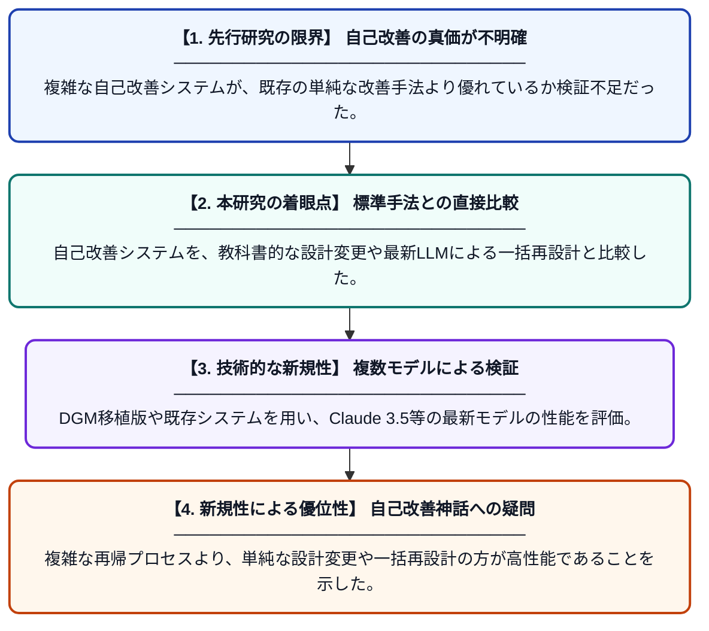

# 自己改善型コーディングエージェントは教科書的なベースラインを超えられるか？：Darwin Gödel Machine移植版と2つの既存システムによる検証

**Original Title**: *Do Self-Improving Coding Agents Beat Textbook Baselines? Evidence from a Darwin Gödel Machine Port and Two Published Systems*

> **💡 一言要約**: AIの「自己改善」幻想を打ち砕く比較検証

| 項目 | 内容 |
|---|---|
| **著者** | TS Tomar |
| **アラートキーワード** | one shot |
| **PDF** | [https://www.researchgate.net/profile/Tejasvi-Singh-Tomar/publication/417004693_Do_Self-Improving_Coding_Agents_Beat_Textbook_Baselines_Evidence_from_a_Darwin_Godel_Machine_Port_and_Two_Published_Systems/links/6ae19912dc41aa6ac30f64c1/Do-Self-Improving-Coding-Agents-Beat-Textbook-Baselines-Evidence-from-a-Darwin-Goedel-Machine-Port-and-Two-Published-Systems.pdf](https://www.researchgate.net/profile/Tejasvi-Singh-Tomar/publication/417004693_Do_Self-Improving_Coding_Agents_Beat_Textbook_Baselines_Evidence_from_a_Darwin_Godel_Machine_Port_and_Two_Published_Systems/links/6ae19912dc41aa6ac30f64c1/Do-Self-Improving-Coding-Agents-Beat-Textbook-Baselines-Evidence-from-a-Darwin-Goedel-Machine-Port-and-Two-Published-Systems.pdf) |
| **原文リンク** | [https://www.researchgate.net/profile/Tejasvi-Singh-Tomar/publication/417004693_Do_Self-Improving_Coding_Agents_Beat_Textbook_Baselines_Evidence_from_a_Darwin_Godel_Machine_Port_and_Two_Published_Systems/links/6ae19912dc41aa6ac30f64c1/Do-Self-Improving-Coding-Agents-Beat-Textbook-Baselines-Evidence-from-a-Darwin-Goedel-Machine-Port-and-Two-Published-Systems.pdf](https://www.researchgate.net/profile/Tejasvi-Singh-Tomar/publication/417004693_Do_Self-Improving_Coding_Agents_Beat_Textbook_Baselines_Evidence_from_a_Darwin_Godel_Machine_Port_and_Two_Published_Systems/links/6ae19912dc41aa6ac30f64c1/Do-Self-Improving-Coding-Agents-Beat-Textbook-Baselines-Evidence-from-a-Darwin-Goedel-Machine-Port-and-Two-Published-Systems.pdf) |
| **PDF版要約** | [README.pdf](./README.pdf) |

---

## 📊 新規性の図解（先行研究との違いと本研究のブレークスルー）

## 📝 要約

自己改善能力を謳うコーディングAIの実力を、標準的なエンジニアリング手法や最新LLMによる一括再設計と比較検証した論文です。調査の結果、複雑な自己改善メカニズムよりも、単純な改良や高性能なモデルによる一発の再設計の方が高い成果を出すケースが多いことが判明しました。

## ❓ どんな問題に取り組んだか

近年、自らを改良し続ける「自己改善型AI」が注目されていますが、それらが既存の標準的な最適化手法や、単に高性能なLLMに再設計を任せる手法と比較して、本当に優れているのかという客観的な評価が不足していました。

## ✨ 何が新しい？何がすごい？（新規性）

本研究は、Darwin Gödel Machineを含む3つの自己改善システムを対象に、標準的なエンジニアリング手法との厳密な比較を行いました。その結果、Claude 3.5 Opusのような最新LLMによる一度のコード再設計が、複雑な再帰的改善プロセスを凌駕することを実証し、過剰な自己改善の主張に対して批判的な視点を提供しました。

## 🎓 大学1年生向けの解説

「AIが自分自身のプログラムを書き換えてどんどん賢くなる」という魔法のような話がありますが、この論文は「それは本当なのか？」を実験で確かめたものです。実験の結果、AIが何度も自分を直そうとするよりも、最新の賢いAIに「一回で綺麗に書き直して」と頼む方が、実は性能が良くなることがわかりました。つまり、複雑な仕組みを作るよりも、基本的な改善の方が今のところは効果的だということです。
