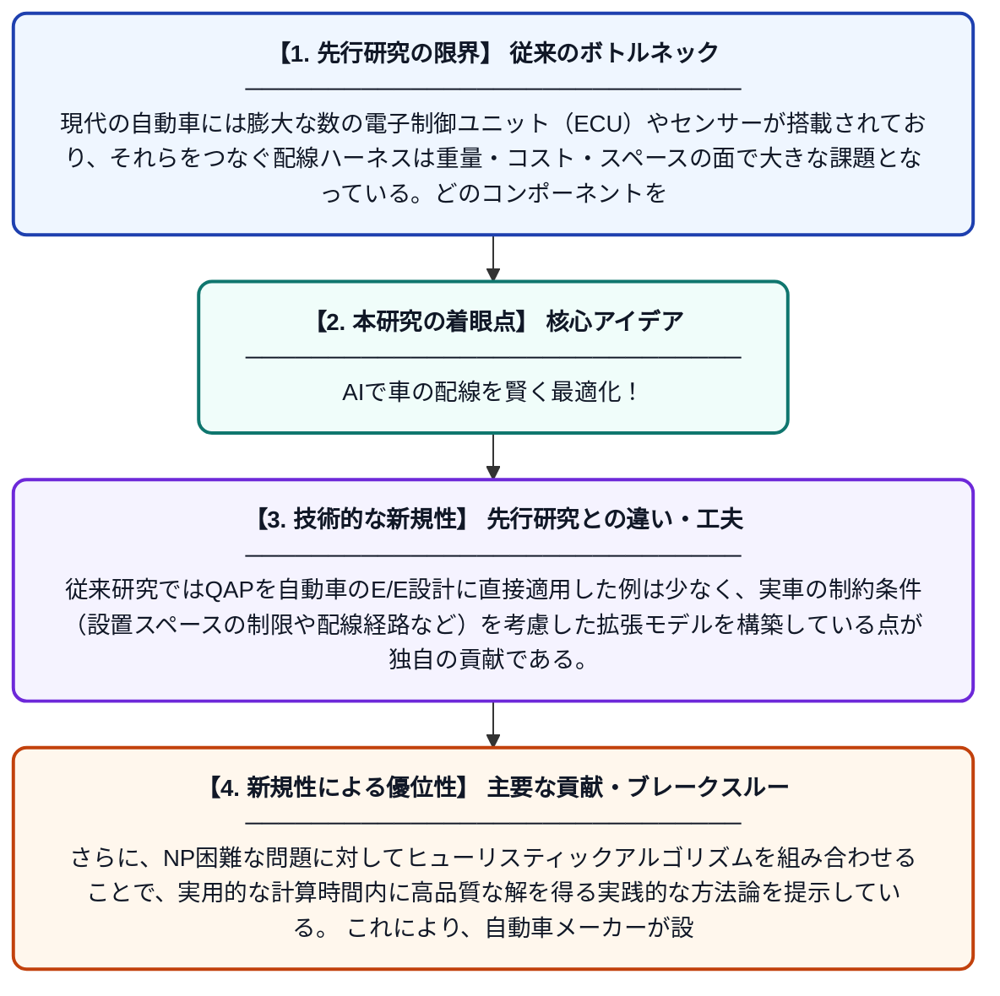

# 自動車における配線ハーネス最適化E/Eパッケージ設計：二次割り当て問題とヒューリスティック最適化アルゴリズムを組み合わせた設計方法論

**Original Title**: *Wiring Harness-Optimized E/E Package in Automotive Vehicles: A Design Methodology combining Quadratic Assignment Problems and Heuristic Optimization Algorithms*

> **💡 一言要約**: AIで車の配線を賢く最適化！

| 項目 | 内容 |
|---|---|
| **著者** | J Schäfer, J Ruhnau, S Rudolph |
| **掲載誌** | IEEE Access 2026 |
| **アラートキーワード** | quadratic assignment problem |
| **PDF** | [https://ieeexplore.ieee.org/iel8/6287639/6514899/11623236.pdf](https://ieeexplore.ieee.org/iel8/6287639/6514899/11623236.pdf) |
| **原文リンク** | [https://ieeexplore.ieee.org/iel8/6287639/6514899/11623236.pdf](https://ieeexplore.ieee.org/iel8/6287639/6514899/11623236.pdf) |
| **PDF版要約** | [README.pdf](./README.pdf) |

---

## 📊 新規性の図解（先行研究との違いと本研究のブレークスルー）

## 📝 要約

本論文は、自動車の電気・電子（E/E）コンポーネントを車両内の設置スペースに最適に配置することで、配線ハーネスの重量やコストを削減する設計手法を提案している。この問題を拡張した二次割り当て問題（QAP）として定式化し、NP困難という計算複雑性に対処するためヒューリスティック最適化アルゴリズムを適用している。これにより、実用的な車両設計プロセスへの組み込みが可能な効率的な解法を実現している。

## ❓ どんな問題に取り組んだか

現代の自動車には膨大な数の電子制御ユニット（ECU）やセンサーが搭載されており、それらをつなぐ配線ハーネスは重量・コスト・スペースの面で大きな課題となっている。どのコンポーネントをどの設置場所に割り当てるかという配置問題は、組み合わせ爆発を引き起こすNP困難問題であり、最適解を現実的な時間内に求めることが極めて難しい。従来の設計プロセスでは経験則に頼ることが多く、システマティックな最適化手法が不足していた。

## ✨ 何が新しい？何がすごい？（新規性）

本研究の新規性は、E/Eコンポーネントの車両内配置問題を「拡張された二次割り当て問題（QAP）」として厳密に定式化した点にある。従来研究ではQAPを自動車のE/E設計に直接適用した例は少なく、実車の制約条件（設置スペースの制限や配線経路など）を考慮した拡張モデルを構築している点が独自の貢献である。さらに、NP困難な問題に対してヒューリスティックアルゴリズムを組み合わせることで、実用的な計算時間内に高品質な解を得る実践的な方法論を提示している。これにより、自動車メーカーが設計初期段階から配線最適化を体系的に実施できる枠組みを提供している。

## 🎓 大学1年生向けの解説

現代の車にはカーナビやエンジン制御など、たくさんの電子部品が搭載されており、それらはすべて電線（配線ハーネス）でつながれています。この電線の束は非常に重く、車全体の重量やコストに大きく影響します。どの部品をどの場所に置けば電線を短くできるかを考えるのが、この研究のテーマです。しかし、置き方の組み合わせが天文学的に多いため、コンピュータでも簡単には解けません。そこでこの研究では、数学的なモデルとAI的な探索アルゴリズムを組み合わせることで、現実的な時間で「なるべく良い配置」を見つける方法を開発しました。
