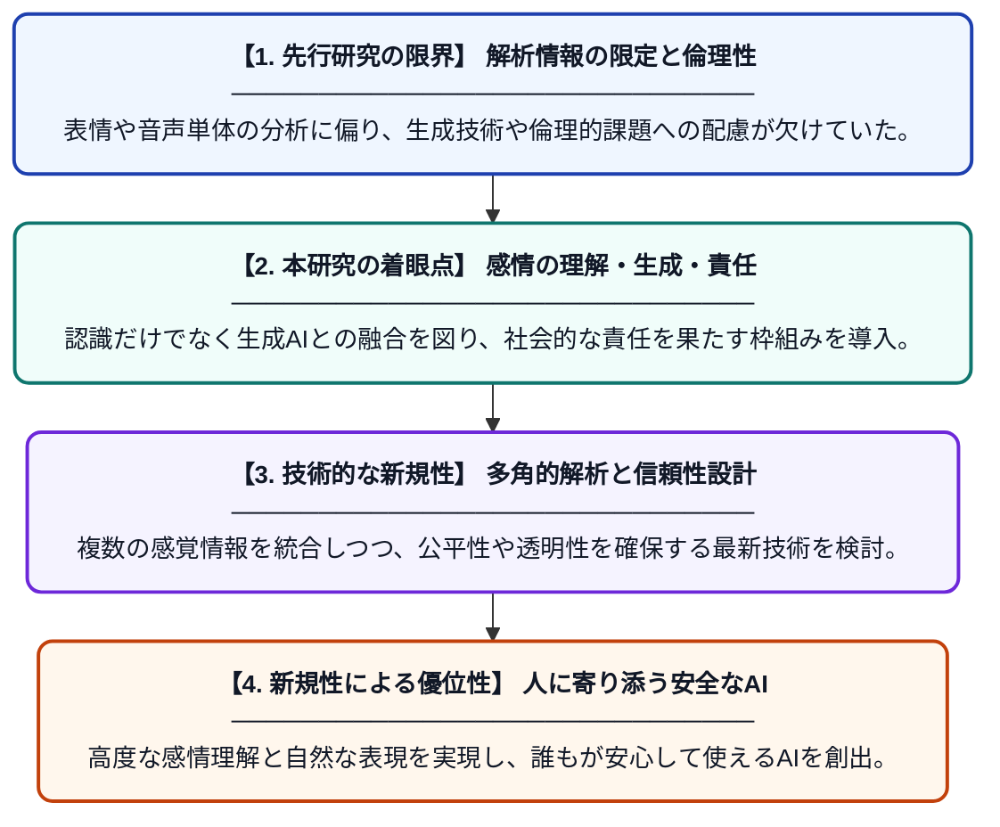

# MRAC 2026：第4回 マルチモーダル・生成型・責任ある感情コンピューティング国際ワークショップ

**Original Title**: *MRAC 2026: 4th International Workshop on Multimodal, Generative and Responsible Affective Computing*

> **💡 一言要約**: 感情を読み、創り、責任を持つAIの未来

| 項目 | 内容 |
|---|---|
| **著者** | Z Lian, S Ghosh, G Zhao, Z Cai, E Cambria, A Dhall… |
| **掲載誌** | Proceedings of the 34th … 2026 |
| **アラートキーワード** | affective computing |
| **原文リンク** | [https://dl.acm.org/doi/abs/10.1145/3767308.3842131](https://dl.acm.org/doi/abs/10.1145/3767308.3842131) |
| **PDF版要約** | [README.pdf](./README.pdf) |

---

## 📊 新規性の図解（先行研究との違いと本研究のブレークスルー）

## 📝 要約

感情コンピューティング分野のさらなる進展を目指し、マルチモーダル解析、生成AI、そして倫理的責任を統合した研究の場を提供しています。研究者が集い、AIが人間の感情を正確に理解し表現するための最新技術と、その安全な社会実装について議論しています。

## ❓ どんな問題に取り組んだか

従来の感情コンピューティングは、単一のデータのみを利用するものが多く、複雑な人間の感情を捉えきれない課題がありました。また、生成AIの急速な発展に伴う悪用リスクや、AIの判断における偏見といった倫理的・社会的な「責任」に関する議論が不足していました。

## ✨ 何が新しい？何がすごい？（新規性）

本ワークショップは、従来の「感情認識」に「生成」と「責任」という2つの現代的視点を強く結びつけた点が革新的です。単に感情を分析するだけでなく、適切な感情表現を生成する技術や、その技術が公平で透明性の高いものであることを保証するための枠組みを同時に構築しています。これにより、技術の高度化と信頼性の確保を両立させる学術的な貢献をしています。

## 🎓 大学1年生向けの解説

AIに「人の気持ちを理解させる」だけでなく、「AI自身が感情を込めて返事をする」ことや「その技術が悪いことに使われないようにする」ことをセットで考える研究です。私たちの表情、声、言葉などを組み合わせて、AIがもっと深く私たちを理解できるよう工夫しています。ただ賢いだけでなく、誰もが安心して使える『優しくて誠実なAI』を作るための世界的な取り組みです。
