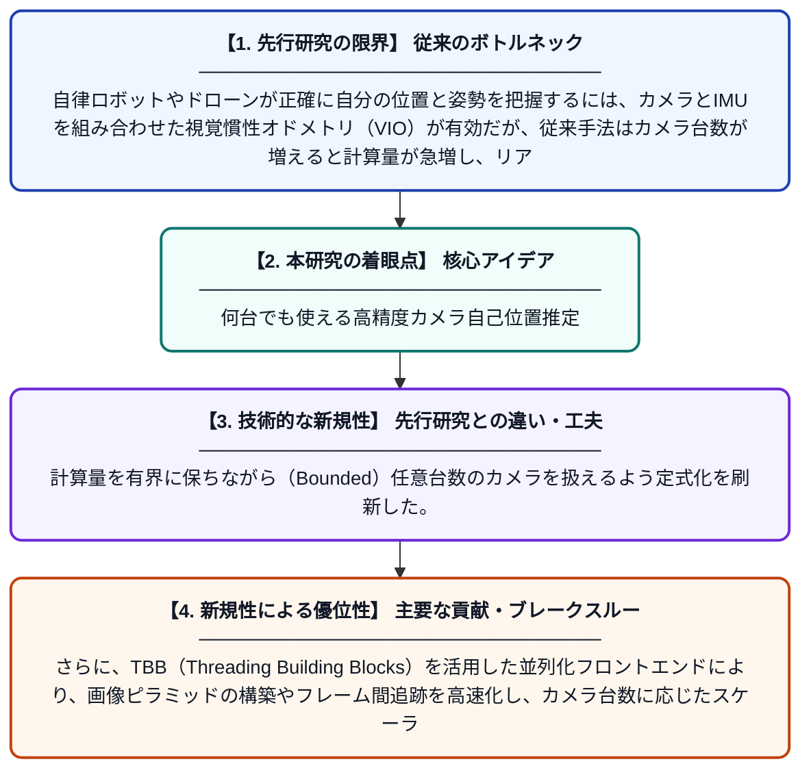

# 有界スライディングウィンドウ最適化によるスケーラブルなマルチカメラ視覚慣性オドメトリ

**Original Title**: *Scalable Multi-Camera VIO with Bounded Sliding-Window Optimization*

> **💡 一言要約**: 何台でも使える高精度カメラ自己位置推定

| 項目 | 内容 |
|---|---|
| **著者** | S Godio, R Costa Fernandes, R Ashour, A Bojko |
| **掲載誌** | Journal of Intelligent & Robotic Systems 2026 |
| **アラートキーワード** | Multi Camera Tracking |
| **原文リンク** | [https://link.springer.com/article/10.1007/s10846-026-02434-5](https://link.springer.com/article/10.1007/s10846-026-02434-5) |
| **PDF版要約** | [README.pdf](./README.pdf) |

---

## 📊 新規性の図解（先行研究との違いと本研究のブレークスルー）

## 📝 要約

本論文では、複数のカメラとIMU（慣性計測装置）を組み合わせてロボットや自律移動体の自己位置推定を行う「マルチカメラVIO」の新しい手法を提案している。Basaltのスライディングウィンドウバンドル調整を拡張し、任意の台数のカメラからの計測を効率的に統合できるシステムを設計した。さらに、TBBによる並列処理を用いたマルチカメラ対応のフロントエンドを実装し、処理のスケーラビリティと実時間性能を両立させている。

## ❓ どんな問題に取り組んだか

自律ロボットやドローンが正確に自分の位置と姿勢を把握するには、カメラとIMUを組み合わせた視覚慣性オドメトリ（VIO）が有効だが、従来手法はカメラ台数が増えると計算量が急増し、リアルタイム処理が困難になる問題があった。また、単眼や二眼カメラを前提とした設計が多く、任意台数のカメラへの柔軟な対応が難しかった。

## ✨ 何が新しい？何がすごい？（新規性）

本研究は、高性能VIOシステムであるBasaltのスライディングウィンドウ最適化をマルチカメラ構成に拡張した点が独自の貢献である。計算量を有界に保ちながら（Bounded）任意台数のカメラを扱えるよう定式化を刷新した。さらに、TBB（Threading Building Blocks）を活用した並列化フロントエンドにより、画像ピラミッドの構築やフレーム間追跡を高速化し、カメラ台数に応じたスケーラブルな処理を実現した。これにより、精度と実時間性能を同時に確保できることを示した。

## 🎓 大学1年生向けの解説

ロボットやドローンが「今自分がどこにいるか」を知るためには、カメラとセンサーを使って周囲の映像から位置を計算する技術が使われます。ところが、カメラを何台も使うと計算量がどんどん増えて、処理が間に合わなくなってしまいます。この研究では、カメラが何台あっても計算量が増えすぎないように工夫した新しい方法を作りました。さらに、コンピューターの複数の処理コアを同時に使う並列処理を取り入れることで、速くて正確な位置推定を実現しました。これにより、ロボットがたくさんのカメラを搭載しても、リアルタイムで安全に動き回れるようになります。
