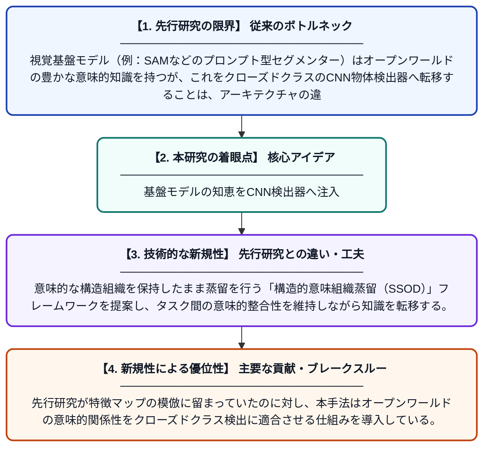

# プロンプト条件付き基盤モデルからCNN検出器へのクロスタスク転移のための構造的意味組織蒸留

**Original Title**: *Structural semantic organization distillation for cross-task transfer from prompt-conditioned foundation models to CNN detectors*

> **💡 一言要約**: 基盤モデルの知恵をCNN検出器へ注入

| 項目 | 内容 |
|---|---|
| **著者** | F Li, Y Guo, G Wang |
| **掲載誌** | Computing 2026 |
| **アラートキーワード** | Open-Vocabulary Object ... |
| **原文リンク** | [https://link.springer.com/article/10.1007/s00607-026-01711-3](https://link.springer.com/article/10.1007/s00607-026-01711-3) |
| **PDF版要約** | [README.pdf](./README.pdf) |

---

## 📊 新規性の図解（先行研究との違いと本研究のブレークスルー）

## 📝 要約

本論文は、プロンプトで制御できる大規模な視覚基盤モデルが持つ豊富な意味的知識を、軽量なCNNベースの物体検出器へ効率的に転移する手法を提案する。この転移は単なるアーキテクチャの違いではなく、セグメンテーションと検出という異なるタスク間の本質的なギャップを乗り越える問題として定式化される。提案手法は構造的な意味組織を保ちながら知識蒸留を行うことで、CNN検出器の精度向上を実現する。

## ❓ どんな問題に取り組んだか

視覚基盤モデル（例：SAMなどのプロンプト型セグメンター）はオープンワールドの豊かな意味的知識を持つが、これをクローズドクラスのCNN物体検出器へ転移することは、アーキテクチャの違いだけでなく、セグメンテーションと検出というタスクの根本的な違いがボトルネックとなる。既存の知識蒸留手法はこのクロスタスクのギャップを十分に考慮しておらず、効果的な知識転移が困難であった。

## ✨ 何が新しい？何がすごい？（新規性）

本研究は、基盤モデルからCNN検出器への転移を「クロスアーキテクチャ問題」ではなく「クロスタスク問題」として明確に再定義した点が新しい。意味的な構造組織を保持したまま蒸留を行う「構造的意味組織蒸留（SSOD）」フレームワークを提案し、タスク間の意味的整合性を維持しながら知識を転移する。先行研究が特徴マップの模倣に留まっていたのに対し、本手法はオープンワールドの意味的関係性をクローズドクラス検出に適合させる仕組みを導入している。

## 🎓 大学1年生向けの解説

AIには画像を細かく分割して理解する「大きな先生モデル」と、特定の物体だけを素早く見つける「小さな生徒モデル」があります。この論文は、先生モデルが持つ「物の意味的なつながり」の知識を、構造を壊さずに生徒モデルへうまく教え込む方法を考えました。難しいのは、先生と生徒がやっていることの「目的」が根本的に違うことで、単純に真似させるだけでは上手くいきません。そこで研究者たちは、意味の「構造」を保ちながら知識を蒸留する新しい仕組みを作り、軽量な検出モデルの性能を大きく向上させることに成功しました。
