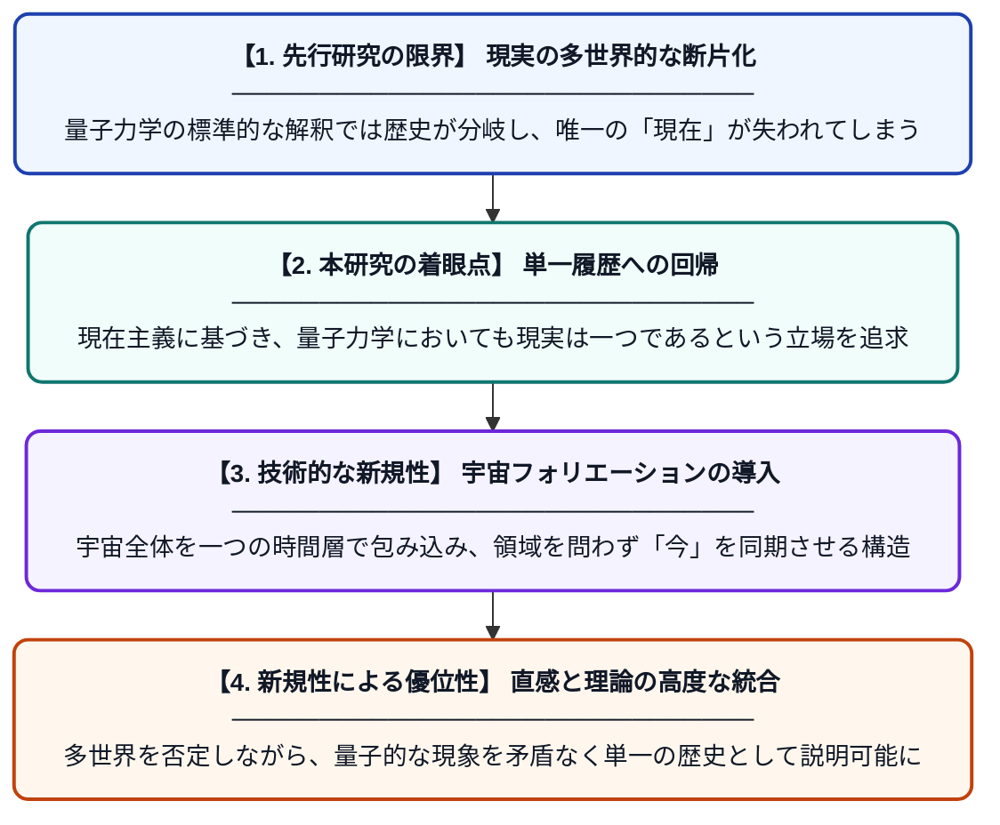

# 確定的現在主義：量子力学における単一履歴の実在論

**Original Title**: *Committed Presentism: A Single-History Ontology of Quantum Mechanics*

> **💡 一言要約**: 量子力学に「唯一の現在」を確立する新理論

| 項目 | 内容 |
|---|---|
| **著者** | C Irrgang |
| **掲載誌** | 2026 |
| **アラートキーワード** | Ontology |
| **PDF** | [https://philarchive.org/archive/IRRCPA](https://philarchive.org/archive/IRRCPA) |
| **原文リンク** | [https://philarchive.org/archive/IRRCPA](https://philarchive.org/archive/IRRCPA) |
| **PDF版要約** | [README.pdf](./README.pdf) |

---

## 📊 新規性の図解（先行研究との違いと本研究のブレークスルー）

## 📝 要約

量子力学において「現在」のみが実在するという現在主義に基づき、並行世界を認めない単一の歴史からなる実在論を提唱しています。宇宙全体を特定の時間的な層（フォリエーション）として定義することで、因果的な領域を超えて統一された「今」を記述する枠組みを構築しました。

## ❓ どんな問題に取り組んだか

量子力学の多くの解釈（多世界解釈など）は、現実が複数に分岐することを前提としており、「今この瞬間だけが実在する」という私たちの直感的な時間観と矛盾します。また、相対性理論の下で宇宙規模の統一された「現在」を客観的に定義することは困難な課題でした。

## ✨ 何が新しい？何がすごい？（新規性）

本論文は「確定的現在主義」を導入し、現実が分岐しない単一の歴史のみを認める実在論を提案しました。従来の現在主義とは異なり、宇宙規模のフォリエーション（葉層構造）を仮定することで、バラバラになりがちな因果領域を一つの「断片化されない現在」として固定した点が画期的です。これにより、量子的な不確定性を保ちつつ、唯一の現実が進行するプロセスを論理的に整合させました。

## 🎓 大学1年生向けの解説

量子力学の世界では「猫が生きている世界と死んでいる世界が同時に存在する」といった不思議な考え方が一般的ですが、この論文はそれに異を唱えます。「実は現実は一つしかなく、今という瞬間だけが本当に存在する」という、私たちの感覚に近い考え方を科学的に証明しようとしています。宇宙全体で共通の「今」を計算できる特別な仕組みを考えることで、並行世界のない、たった一つの歴史を説明することに成功しています。
