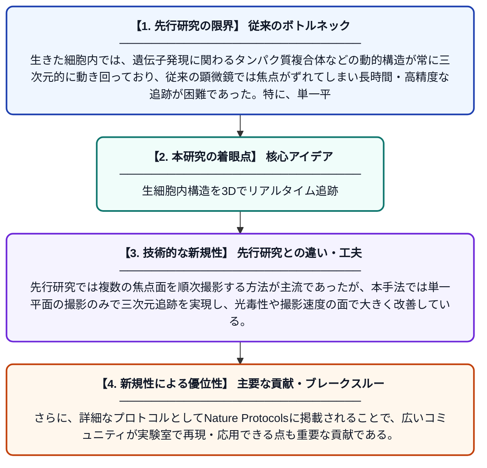

# フォーカスフィードバックを用いた単一平面イメージングによる生細胞内動的構造の三次元追跡

**Original Title**: *Three-dimensional tracking of dynamic structures in living cells using single-plane imaging with focus feedback*

> **💡 一言要約**: 生細胞内構造を3Dでリアルタイム追跡

| 項目 | 内容 |
|---|---|
| **著者** | SV Antonova, W Pomp, JVW Meeussen, TL Lenstra |
| **掲載誌** | Nature Protocols 2026 |
| **アラートキーワード** | Multi Camera Tracking |
| **原文リンク** | [https://www.nature.com/articles/s41596-026-01419-w](https://www.nature.com/articles/s41596-026-01419-w) |
| **PDF版要約** | [README.pdf](./README.pdf) |

---

## 📊 新規性の図解（先行研究との違いと本研究のブレークスルー）

## 📝 要約

本論文は、生きた細胞内で動き続ける微細構造をリアルタイムに三次元追跡するための新しい顕微鏡プロトコルを提案している。焦点位置を自動補正するフィードバック機構と円柱レンズを組み合わせることで、単一平面の撮影のみで三次元情報を取得できる。最適な追跡領域の選び方やGUIを用いたリアルタイムフィードバックの解釈方法など、実用的なガイダンスも詳しく記述されている。

## ❓ どんな問題に取り組んだか

生きた細胞内では、遺伝子発現に関わるタンパク質複合体などの動的構造が常に三次元的に動き回っており、従来の顕微鏡では焦点がずれてしまい長時間・高精度な追跡が困難であった。特に、単一平面のみで撮影しながら三次元位置情報を得ることは技術的に大きな課題であった。

## ✨ 何が新しい？何がすごい？（新規性）

本研究は、円柱レンズによる非点収差を利用してスポット形状から深さ方向（Z軸）の位置を推定しつつ、フォーカスフィードバック機構によって焦点を動的に自動補正するという手法を組み合わせた点が新しい。先行研究では複数の焦点面を順次撮影する方法が主流であったが、本手法では単一平面の撮影のみで三次元追跡を実現し、光毒性や撮影速度の面で大きく改善している。さらに、詳細なプロトコルとしてNature Protocolsに掲載されることで、広いコミュニティが実験室で再現・応用できる点も重要な貢献である。

## 🎓 大学1年生向けの解説

私たちの体の細胞の中では、タンパク質などの小さな粒子が常に動き回っています。この動きを顕微鏡でずっと追いかけるのは、カメラのピントが合わなくなるため非常に難しい作業です。この研究では、特殊なレンズと自動ピント合わせの仕組みを組み合わせることで、1枚の平面画像を撮るだけで立体的な動きを追跡できる方法を開発しました。例えるなら、一台のカメラだけで飛んでいるハチドリの三次元的な動きを常に追い続けるようなことが可能になった、という画期的な技術です。
