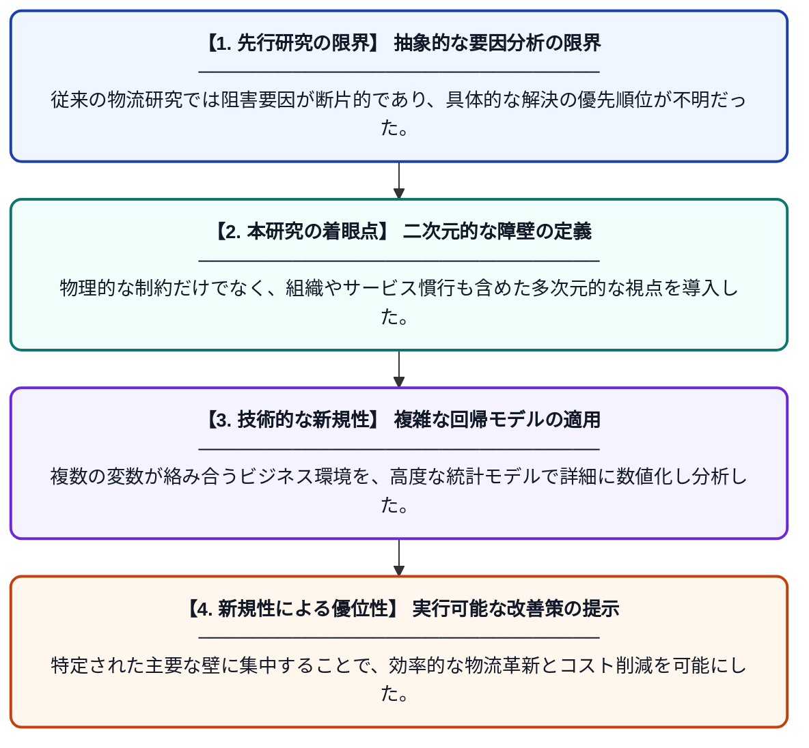

# モロッコ企業における物流革新を阻害する二次元的な主要障壁：複雑な回帰モデリングを用いた分析

**Original Title**: *Key Bidimensional Barriers to Logistics Innovation in Moroccan Enterprises Using Complex Regression Modelling*

> **💡 一言要約**: 物流革新を阻む壁をデータで解明！

| 項目 | 内容 |
|---|---|
| **著者** | FZ Benbrahim, EH Bouichou, MO Garti, J Arif, H Dincer… |
| **掲載誌** | Journal of Entrepreneurship … 2026 |
| **アラートキーワード** | logistics |
| **原文リンク** | [https://journals.sagepub.com/doi/abs/10.1177/23939575261501641](https://journals.sagepub.com/doi/abs/10.1177/23939575261501641) |
| **PDF版要約** | [README.pdf](./README.pdf) |

---

## 📊 新規性の図解（先行研究との違いと本研究のブレークスルー）

## 📝 要約

本研究は、モロッコ企業が物流コストを削減し、変化するビジネスニーズに対応するために直面している物流革新の阻害要因を調査しています。複雑な回帰モデルを活用することで、プロセス、サービス、慣行における革新を妨げる主要な障壁を二次元的な視点から特定しました。

## ❓ どんな問題に取り組んだか

多くの企業において物流コストの削減は経営上の大きな課題ですが、モロッコ企業における物流革新を阻む具体的な要因は十分に解明されていませんでした。既存のプロセスやサービスを改善しようとしても、どの障壁が優先的に解決されるべきかが不明確であり、効率的な投資が困難な状況にありました。

## ✨ 何が新しい？何がすごい？（新規性）

本研究の最大の貢献は、物流革新の阻害要因を「二次元的な障壁」という独自の枠組みで整理し、複雑な回帰モデリングを用いて定量化した点にあります。先行研究では断片的であった要因分析を統合し、複数の変数が複雑に絡み合うビジネス環境下で、どの要因が最も革新を妨げているかを高い精度で算出しました。これにより、理論的な枠組みと実践的なデータ分析を融合させた、新たな評価モデルを構築しています。

## 🎓 大学1年生向けの解説

物流とは、商品を運んだり保管したりする仕組みのことです。この論文は、モロッコの会社がその仕組みをもっと新しく効率的にしようとしたときに、何が邪魔をしているのかを調べた研究です。難しい数学的なモデルを使って、お金や技術、あるいは古いやり方など、どの問題が一番の「壁」になっているのかを突き止めました。これを知ることで、会社は無駄なコストを減らすための正しい作戦を立てられるようになります。
