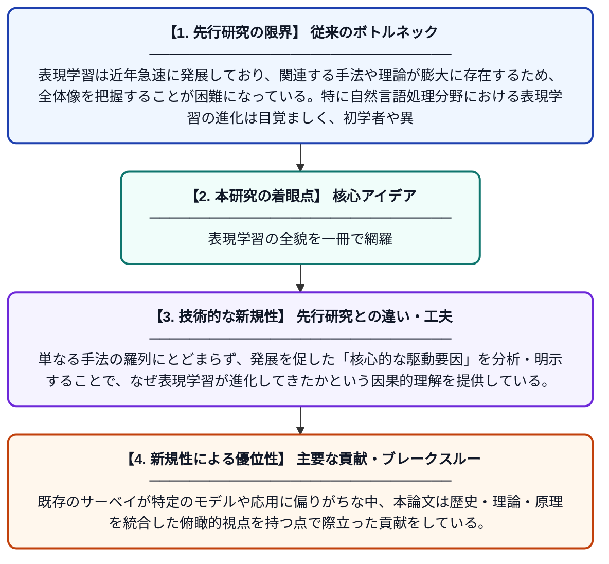

# 表現学習の歴史・発展・原理：入門的サーベイ

**Original Title**: *History, Development, and Principles of Representation Learning—An Introductory Survey*

> **💡 一言要約**: 表現学習の全貌を一冊で網羅

| 項目 | 内容 |
|---|---|
| **著者** | Z Wang, Q He, J Mou, W Wang, J Chen |
| **掲載誌** | Expert Systems 2026 |
| **アラートキーワード** | representation learning |
| **原文リンク** | [https://onlinelibrary.wiley.com/doi/abs/10.1111/exsy.70370](https://onlinelibrary.wiley.com/doi/abs/10.1111/exsy.70370) |
| **PDF版要約** | [README.pdf](./README.pdf) |

---

## 📊 新規性の図解（先行研究との違いと本研究のブレークスルー）

## 📝 要約

本論文は、表現学習の歴史的背景から現代的な発展に至るまでを包括的にまとめた入門的サーベイである。自然言語処理を中心に、表現学習がいかにAI分野の進歩を牽引してきたかを分析し、その中核となる駆動要因と基本原理を体系的に解説している。表現学習の基礎理論から応用までを整理することで、研究者や学習者が全体像を把握できるよう設計されている。

## ❓ どんな問題に取り組んだか

表現学習は近年急速に発展しており、関連する手法や理論が膨大に存在するため、全体像を把握することが困難になっている。特に自然言語処理分野における表現学習の進化は目覚ましく、初学者や異分野の研究者にとって体系的な入門資料が不足していた。

## ✨ 何が新しい？何がすごい？（新規性）

本サーベイは、表現学習の歴史的経緯・発展プロセス・基本原理を一貫した視点で整理した点が新しい。単なる手法の羅列にとどまらず、発展を促した「核心的な駆動要因」を分析・明示することで、なぜ表現学習が進化してきたかという因果的理解を提供している。既存のサーベイが特定のモデルや応用に偏りがちな中、本論文は歴史・理論・原理を統合した俯瞰的視点を持つ点で際立った貢献をしている。

## 🎓 大学1年生向けの解説

コンピュータにデータを「うまく理解させる」ための技術を「表現学習」と呼びます。例えば、「猫」という言葉や画像をコンピュータが意味のある数値の集まりとして捉えられるようにする仕組みです。この論文は、そうした表現学習がどのように生まれ、どう発展してきたかを歴史的にまとめた「教科書のような解説論文」です。難しい専門用語や最新技術も、基礎原理から順番に説明されているので、初めて学ぶ人にも理解しやすい内容になっています。
