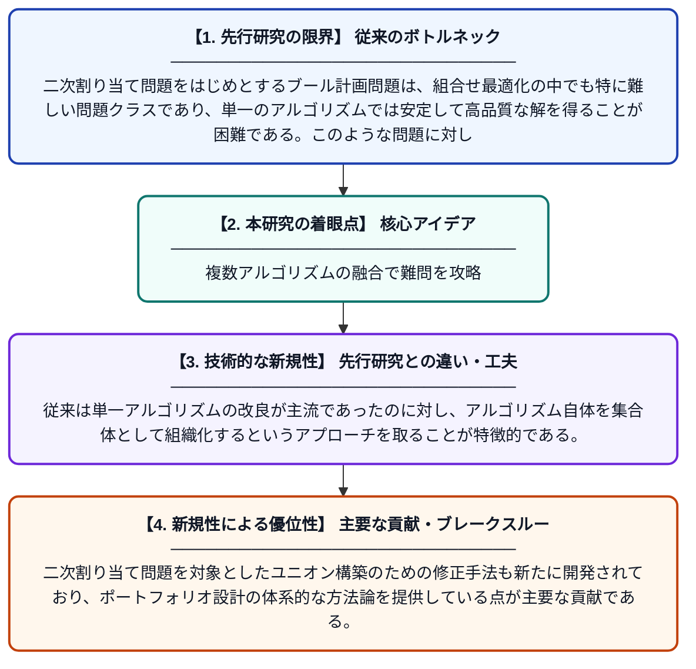

# ブール計画問題の特定クラスへのアルゴリズムユニオンの適用

**Original Title**: *Applying Algorithm Unions to Specific Classes of Boolean Programming Problems*

> **💡 一言要約**: 複数アルゴリズムの融合で難問を攻略

| 項目 | 内容 |
|---|---|
| **著者** | IV Sergienko, VP Shylo, VO Roshchyn, DO Boyarchuk |
| **掲載誌** | Cybernetics and Systems Analysis 2026 |
| **アラートキーワード** | quadratic assignment problem |
| **原文リンク** | [https://link.springer.com/article/10.1007/s10559-026-00893-0](https://link.springer.com/article/10.1007/s10559-026-00893-0) |
| **PDF版要約** | [README.pdf](./README.pdf) |

---

## 📊 新規性の図解（先行研究との違いと本研究のブレークスルー）

## 📝 要約

本論文は、ブール計画問題（特に二次割り当て問題）に対して、複数のアルゴリズムを組み合わせた「アルゴリズムユニオン（集合体）」を構築・適用する研究である。RITSKアルゴリズムの同質ポートフォリオを構成し、その性能を検証している。アルゴリズムの組み合わせ方を工夫することで、単一アルゴリズムよりも高い求解性能を実現することを目的としている。

## ❓ どんな問題に取り組んだか

二次割り当て問題をはじめとするブール計画問題は、組合せ最適化の中でも特に難しい問題クラスであり、単一のアルゴリズムでは安定して高品質な解を得ることが困難である。このような問題に対して、どのようにアルゴリズムを組み合わせれば効率的かつ効果的に解けるかが課題となっている。

## ✨ 何が新しい？何がすごい？（新規性）

本研究では、RITSKアルゴリズムを複数組み合わせた「同質ポートフォリオ」という新しいアルゴリズムユニオンの枠組みを提案している。従来は単一アルゴリズムの改良が主流であったのに対し、アルゴリズム自体を集合体として組織化するというアプローチを取ることが特徴的である。二次割り当て問題を対象としたユニオン構築のための修正手法も新たに開発されており、ポートフォリオ設計の体系的な方法論を提供している点が主要な貢献である。

## 🎓 大学1年生向けの解説

「二次割り当て問題」とは、たとえば工場内の機械の配置を最適化するような、非常に多くの組み合わせから最良の答えを探す難しい問題です。コンピュータが一つの解き方（アルゴリズム）だけを使っても、うまくいかないことがあります。そこでこの研究では、複数の解き方を組み合わせたチーム（アルゴリズムユニオン）を作り、協力して問題を解く方法を提案しています。サッカーでも一人のスター選手より、役割分担したチームの方が強いのと同じ発想です。この手法によって、難しい問題でもより良い解が得られることを実証しています。
