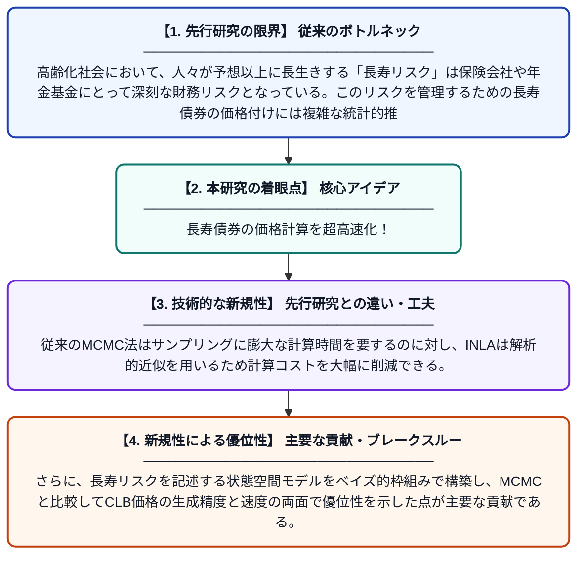

# ベイズ統合ネストラプラス近似（INLA）を用いた長寿債券市場モデル

**Original Title**: *Bayesian Integrated Nested Laplace Approximation (INLA) Longevity Bonds Market Model*

> **💡 一言要約**: 長寿債券の価格計算を超高速化！

| 項目 | 内容 |
|---|---|
| **著者** | Y Sithole, SA Gyamerah |
| **掲載誌** | Risks 2026 |
| **アラートキーワード** | MCMC |
| **原文リンク** | [https://www.mdpi.com/2227-9091/14/8/172](https://www.mdpi.com/2227-9091/14/8/172) |
| **PDF版要約** | [README.pdf](./README.pdf) |

---

## 📊 新規性の図解（先行研究との違いと本研究のブレークスルー）

## 📝 要約

本論文は、長寿リスクを証券化した「長寿債券（CLB）」の価格付けにおいて、従来のMCMC法に代わるINLA（統合ネストラプラス近似）を応用した新しい市場モデルを提案する。状態空間モデルを構築し、INLAが周辺事後分布を通じてCLB価格を生成する際にMCMCよりも大幅に計算効率が高いことを示す。ベイズ推定の枠組みを活用することで、長寿リスクの不確実性をより迅速かつ正確に定量化できることを実証している。

## ❓ どんな問題に取り組んだか

高齢化社会において、人々が予想以上に長生きする「長寿リスク」は保険会社や年金基金にとって深刻な財務リスクとなっている。このリスクを管理するための長寿債券の価格付けには複雑な統計的推定が必要であり、従来のMCMC法では計算コストが非常に高く、実用上の制約となっていた。より効率的かつ精度の高い価格算出手法の開発が求められていた。

## ✨ 何が新しい？何がすごい？（新規性）

本研究の最大の新規性は、長寿債券の価格付けに初めてINLA（統合ネストラプラス近似）を適用した点にある。従来のMCMC法はサンプリングに膨大な計算時間を要するのに対し、INLAは解析的近似を用いるため計算コストを大幅に削減できる。さらに、長寿リスクを記述する状態空間モデルをベイズ的枠組みで構築し、MCMCと比較してCLB価格の生成精度と速度の両面で優位性を示した点が主要な貢献である。

## 🎓 大学1年生向けの解説

人間が平均より長く生きることを「長寿リスク」といい、これは保険会社にとって大きな問題です。このリスクを金融商品（長寿債券）として売買するためには、その商品の「値段」を計算する必要があります。従来の計算方法はとても時間がかかりましたが、この論文では「INLA」という数学的なテクニックを使って、同じ計算をずっと速くできることを示しました。料理に例えるなら、数時間かかっていた煮込み料理を電子レンジで数分に短縮するような革新です。
