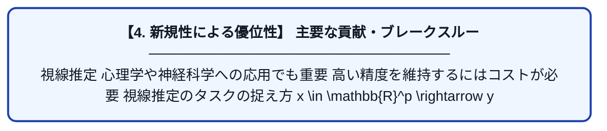

# Mixed Effects Neural Networks (MeNets) with Applications to Gaze Estimation

| 項目 | 内容 |
|---|---|
| **PDF版要約** | [README.pdf](./README.pdf) |

---

## 📊 新規性の図解（先行研究との違いと本研究のブレークスルー）

## 📝 要約

視線推定

心理学や神経科学への応用でも重要

高い精度を維持するにはコストが必要

視線推定のタスクの捉え方

x \in \mathbb{R}^p \rightarrow y \in \mathbb{R}^3

統計的な仮定が満たされているかどうかを確認するのは、精度向上の自然なステップだ。

(A)The Eyediap dataset
