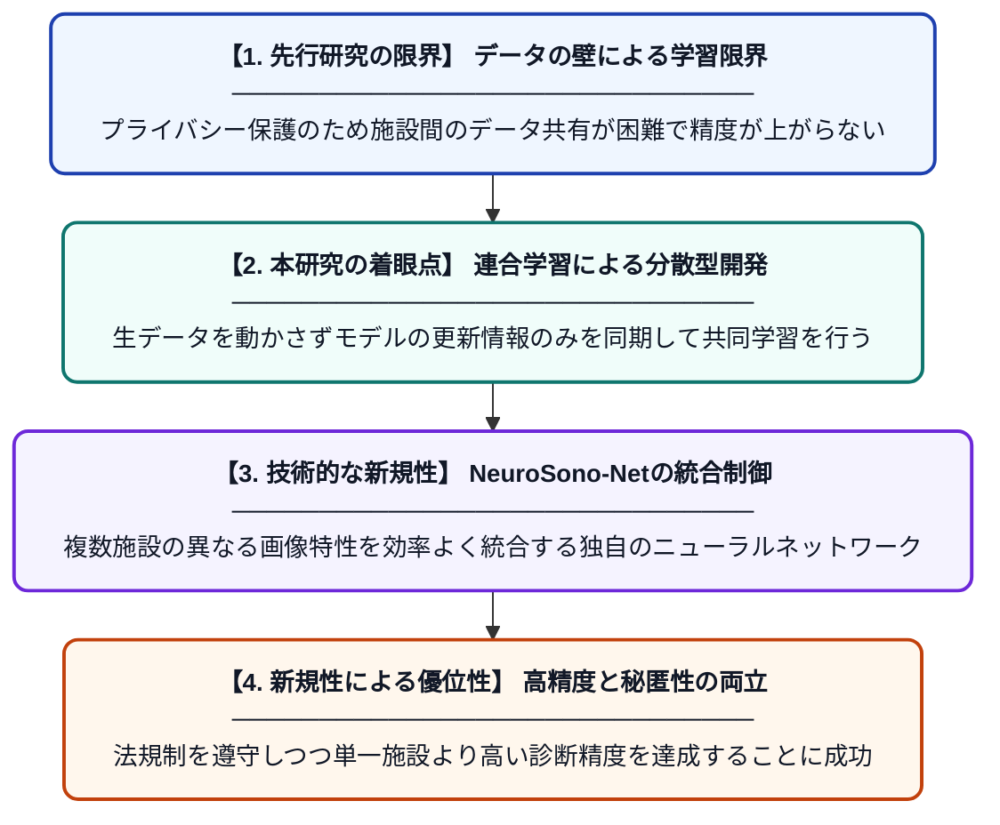

# NeuroSono-Net：プライバシーを保護しつつ複数施設で連携する新生児脳超音波診断用連合学習

**Original Title**: *NeuroSono-Net federated learning for privacy preserving multi institution neonatal brain ultrasound diagnosis*

> **💡 一言要約**: データを共有せず新生児の脳を診る連合学習

| 項目 | 内容 |
|---|---|
| **著者** | SA Alotaibi |
| **掲載誌** | Multimedia Tools and Applications 2026 |
| **アラートキーワード** | Federated Learning |
| **原文リンク** | [https://link.springer.com/article/10.1007/s11042-026-21987-z](https://link.springer.com/article/10.1007/s11042-026-21987-z) |
| **PDF版要約** | [README.pdf](./README.pdf) |

---

## 📊 新規性の図解（先行研究との違いと本研究のブレークスルー）

## 📝 要約

患者の機密データを施設外に持ち出すことなく、複数の医療機関が共同で新生児の脳超音波診断AIを訓練できる新フレームワーク「NeuroSono-Net」を提案しました。連合学習を活用することで、プライバシー規制を遵守しながら、単一施設では困難だった高精度な診断モデルの構築を可能にしています。

## ❓ どんな問題に取り組んだか

新生児の脳超音波診断において、精度の高いAIを作るには大量のデータが必要ですが、医療データはプライバシー保護のため病院間での共有が厳しく制限されています。このため、各病院が持つ限られたデータだけでは、希少な症例に対応できる汎用的なモデルを開発できないという課題がありました。

## ✨ 何が新しい？何がすごい？（新規性）

本研究は、データを一箇所に集約せずにモデルを学習させる「連合学習（Federated Learning）」を、新生児の脳超音波診断に特化した形で初めて導入しました。独自の「NeuroSono-Net」アーキテクチャにより、各施設特有の画像の差異を吸収しつつ、診断に不可欠な共通特徴を効率的に抽出する仕組みを構築しています。これにより、プライバシーを完全に保護した状態で、複数の病院が協力して単一施設のデータのみを用いた場合を上回る診断性能を実現しました。

## 🎓 大学1年生向けの解説

赤ちゃんの脳の健康状態をAIでチェックするには、たくさんの画像を見て学習する必要がありますが、病院のデータを外に出すことは法律で厳しく禁止されています。そこで、画像そのものは病院から出さずに、AIの「学習した知識」だけをインターネット経由で集めて合体させる、賢い仕組みを作りました。これによって、プライバシーを守りながら、世界中の病院が協力して最高レベルのAIドクターを育てることができるようになります。
