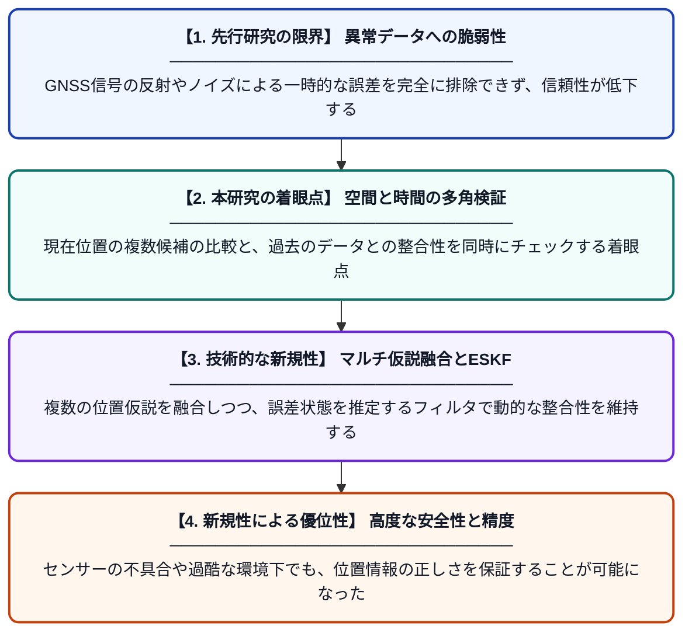

# 空間的マルチ仮説融合と時間的一貫性を用いた車両位置推定の完全性向上

**Original Title**: *Localization Integrity for Vehicles with Spatial Multi-Hypothesis Fusion and Temporal Consistency*

> **💡 一言要約**: 空間と時間の二重チェックで自動運転の安全を守る

| 項目 | 内容 |
|---|---|
| **著者** | G Liu, G Guo, Y Wang, Y Liu, X Liu, J Liu |
| **掲載誌** | IEEE Transactions on Instrumentation and … 2026 |
| **アラートキーワード** | kalman filter  "anomaly ... |
| **原文リンク** | [https://ieeexplore.ieee.org/abstract/document/11797632/](https://ieeexplore.ieee.org/abstract/document/11797632/) |
| **PDF版要約** | [README.pdf](./README.pdf) |

---

## 📊 新規性の図解（先行研究との違いと本研究のブレークスルー）

## 📝 要約

GNSSとIMUを統合した車両の自己位置推定において、空間的な複数仮説の融合と時間的な整合性確認を組み合わせることで、推定結果の信頼性（インテグリティ）を強化する手法を提案しています。センサーの異常や環境ノイズによる位置誤差を効果的に検出し排除することで、自動運転などの安全性を高めています。

## ❓ どんな問題に取り組んだか

GNSS信号が建物に反射したり遮られたりする環境では、位置推定に大きな誤差が生じ、車両が誤った位置を信じてしまうリスクがあります。従来の統合手法では、突発的なセンサーの異常や一時的な環境ノイズを完全に排除することが難しく、位置情報の信頼性を数学的に保証することが困難でした。

## ✨ 何が新しい？何がすごい？（新規性）

本研究は、誤差状態拡張カルマンフィルタ（ESKF）を基盤とし、空間的な「マルチ仮説融合」と時間的な「一貫性チェック」を統合した点に新規性があります。複数の位置候補を同時に評価する空間的なアプローチと、過去の推移との矛盾を検証する時間的なアプローチを組み合わせることで、先行研究よりも頑健に異常を検知できます。これにより、複雑な都市環境においても位置推定の完全性（Integrity）を高く維持することに成功しました。

## 🎓 大学1年生向けの解説

自動運転車が「自分がどこにいるか」を正確に知ることは非常に重要ですが、GPSは高い建物の近くなどで嘘の情報を出すことがあります。この研究は、その嘘を見破るために「今いる場所の候補をいくつか用意して比べる」方法と「これまでの動きからして今の位置がおかしくないか確認する」方法の2つを同時に行います。たとえセンサーが一つ間違った値を出しても、この仕組みがあれば騙されずに、自分の場所を正しく安全に把握し続けることができます。
