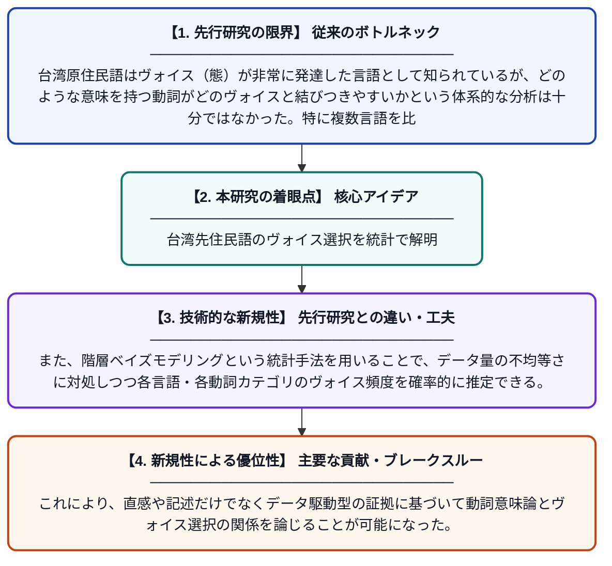

# ヤミ語・アタヤル語・パイワン語におけるヴォイス選好：階層ベイズ分析

**Original Title**: *Voice Preferences Across Yami, Atayal and Paiwan Languages: A Hierarchical Bayesian analysis*

> **💡 一言要約**: 台湾先住民語のヴォイス選択を統計で解明

| 項目 | 内容 |
|---|---|
| **著者** | K Lin, JN Watty, D Watty, P O'Neil, JK Hartshorne |
| **掲載誌** | Proceedings of the Annual Meeting of the Cognitive Science Society 2026 |
| **アラートキーワード** | Bayesian hierarchical ... |
| **PDF** | [https://escholarship.org/content/qt5t97944h/qt5t97944h.pdf](https://escholarship.org/content/qt5t97944h/qt5t97944h.pdf) |
| **原文リンク** | [https://escholarship.org/content/qt5t97944h/qt5t97944h.pdf](https://escholarship.org/content/qt5t97944h/qt5t97944h.pdf) |
| **PDF版要約** | [README.pdf](./README.pdf) |

---

## 📊 新規性の図解（先行研究との違いと本研究のブレークスルー）

## 📝 要約

本研究は、台湾原住民諸語（アタヤル語・パイワン語・ヤミ語）のアノテーション済みコーパスに含まれる動詞を分析し、動詞の意味とヴォイスパターンの関係を探った。階層ベイズモデリングを用いて、各言語における確率的なヴォイス頻度を推定した。動詞の意味カテゴリがヴォイス選択にどのように影響するかを統計的に明らかにすることを目的としている。

## ❓ どんな問題に取り組んだか

台湾原住民語はヴォイス（態）が非常に発達した言語として知られているが、どのような意味を持つ動詞がどのヴォイスと結びつきやすいかという体系的な分析は十分ではなかった。特に複数言語を比較しながら動詞意味論とヴォイスパターンの関係を定量的に検討した研究は少ない。

## ✨ 何が新しい？何がすごい？（新規性）

複数の台湾原住民語のコーパスを横断的に比較する点が新しく、単一言語の記述研究にとどまらない言語間比較を可能にしている。また、階層ベイズモデリングという統計手法を用いることで、データ量の不均等さに対処しつつ各言語・各動詞カテゴリのヴォイス頻度を確率的に推定できる。これにより、直感や記述だけでなくデータ駆動型の証拠に基づいて動詞意味論とヴォイス選択の関係を論じることが可能になった。

## 🎓 大学1年生向けの解説

台湾には独自の言語を持つ先住民族がいて、彼らの言語には動詞の「態（ヴォイス）」という文法的な特徴が非常に豊かに発達しています。たとえば日本語でも「食べる」「食べられる」のように同じ動詞を形を変えて使いますが、台湾原住民語ではこれがさらに複雑です。この研究では、どんな意味を持つ動詞がどんな「態」と一緒に使われやすいかを、大量の文章データとベイズ統計という数学的な手法で調べました。複数の言語を比較することで、こうした傾向が言語をまたいで共通するのかどうかも検証しています。
