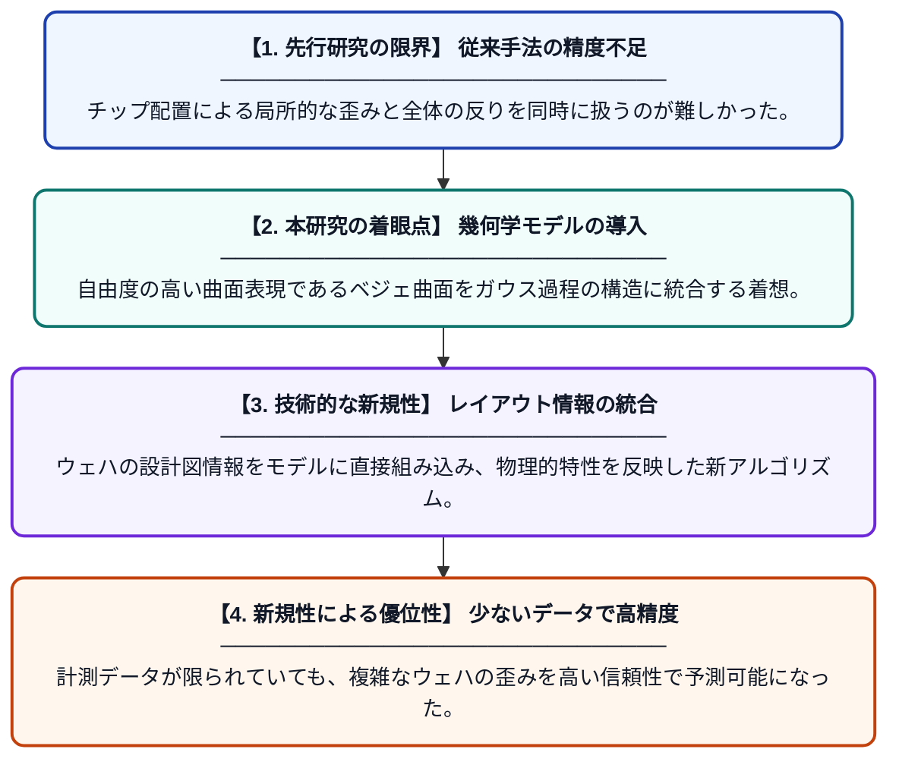

# Bézier-GP: ベジェ曲面に基づくガウス過程を用いたチップ・オン・ウェハの反りモデリング

**Original Title**: *Bezier-GP: Bezier-Surface-Based Gaussian Process for Chips-on-Wafer Warpage Modeling*

> **💡 一言要約**: ベジェ曲面とAIでウェハの反りを精密に予測

| 項目 | 内容 |
|---|---|
| **著者** | S Lee, X Liu, J Shi |
| **掲載誌** | arXiv preprint arXiv:2611.04280 2026 |
| **アラートキーワード** | gaussian process |
| **PDF** | [https://arxiv.org/pdf/2611.04280](https://arxiv.org/pdf/2611.04280) |
| **原文リンク** | [https://arxiv.org/pdf/2611.04280](https://arxiv.org/pdf/2611.04280) |
| **PDF版要約** | [README.pdf](./README.pdf) |

---

## 📊 新規性の図解（先行研究との違いと本研究のブレークスルー）

## 📝 要約

半導体製造のチップ・オン・ウェハ工程で発生するウェハの反りを、ベジェ曲面とガウス過程を組み合わせて高精度に予測する新手法「Bézier-GP」を提案しています。ウェハの点群データとレイアウト情報を統合することで、複雑な表面形状のモデル化を実現しました。

## ❓ どんな問題に取り組んだか

半導体の高密度化に伴い、ウェハの反り（ワーページ）は接合不良を招く重大な課題となっています。しかし、チップの配置による局所的な剛性の変化や複雑な熱変形を、従来の統計モデルで正確かつ効率的に捉えることは困難でした。

## ✨ 何が新しい？何がすごい？（新規性）

本研究の最大の特徴は、柔軟な形状表現が可能な「ベジェ曲面」をガウス過程のカーネル構造に組み込んだ点にあります。ウェハマップのレイアウト情報を設計段階からモデルに組み込むことで、チップの有無による物理的な歪みの違いを明示的に考慮できるようになりました。これにより、従来の標準的なガウス過程よりも少ないサンプル数で、より現実に即した滑らかかつ複雑な表面形状を再現することが可能です。

## 🎓 大学1年生向けの解説

パソコンやスマホの脳にあたる半導体を作る際、薄い円盤（ウェハ）の上に小さなチップをたくさん載せますが、熱などでウェハがポテトチップスのように反ってしまうことがあります。この反りがひどいと故障の原因になります。この研究では、デザイナーが滑らかな曲線を描くのに使う「ベジェ曲線」という数学的な技と、AIの予測技術を合体させました。これにより、ウェハのどこがどれくらい曲がるかを正確に予知できるようになり、失敗の少ないモノづくりに役立ちます。
