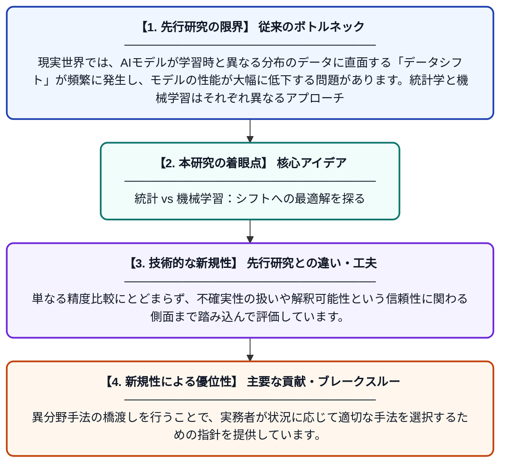

# データシフトへの対処におけるベイズ階層モデルとモデル非依存メタ学習の比較

**Original Title**: *A Comparison of Hierarchical Bayes and Model-Agnostic Meta-Learning for Addressing Data Shift*

> **💡 一言要約**: 統計 vs 機械学習：シフトへの最適解を探る

| 項目 | 内容 |
|---|---|
| **著者** | S Myren, C Stakun-Pickering, D Higdon, L House |
| **掲載誌** | Workshop on Statistics and Trustworthy AI |
| **アラートキーワード** | Bayesian hierarchical ... |
| **PDF** | [https://openreview.net/pdf?id=C3hdrTmpjH](https://openreview.net/pdf?id=C3hdrTmpjH) |
| **原文リンク** | [https://openreview.net/pdf?id=C3hdrTmpjH](https://openreview.net/pdf?id=C3hdrTmpjH) |
| **PDF版要約** | [README.pdf](./README.pdf) |

---

## 📊 新規性の図解（先行研究との違いと本研究のブレークスルー）

## 📝 要約

本論文は、データシフト（訓練データとテストデータの分布がずれる問題）に対処するための手法として、統計学分野で用いられるベイズ階層モデル（BHM）と機械学習分野のモデル非依存メタ学習（FOMAML）を比較検討したものです。解釈可能性・予測性能・不確実性の定量化という3つの観点から両手法を評価しています。異なる分野の手法を横断的に比較することで、それぞれの強みと弱みを明らかにしています。

## ❓ どんな問題に取り組んだか

現実世界では、AIモデルが学習時と異なる分布のデータに直面する「データシフト」が頻繁に発生し、モデルの性能が大幅に低下する問題があります。統計学と機械学習はそれぞれ異なるアプローチでこの問題に取り組んできましたが、両者を直接比較した研究は少なく、どの場面でどちらが優れているかが不明確でした。

## ✨ 何が新しい？何がすごい？（新規性）

本研究は、従来別々のコミュニティで独立して発展してきたベイズ階層モデル（BHM）と一次近似MAMLという二つの手法を、同一の評価軸（解釈可能性・性能・不確実性）で比較した点が新しいです。単なる精度比較にとどまらず、不確実性の扱いや解釈可能性という信頼性に関わる側面まで踏み込んで評価しています。異分野手法の橋渡しを行うことで、実務者が状況に応じて適切な手法を選択するための指針を提供しています。

## 🎓 大学1年生向けの解説

AIは、学習したデータと違う種類のデータが来ると急に精度が落ちてしまうことがあります。これを「データシフト」と呼びます。この問題を解決する方法として、統計学者がよく使う「ベイズ階層モデル」と、機械学習研究者がよく使う「メタ学習」という2つのアプローチがあります。この論文は、どちらの方法がより使いやすく、正確で、自信の度合いをうまく表現できるかを比べた研究です。まるで「数学的なアプローチvs直感的な学習アプローチ」の対決を科学的に検証したようなイメージです。
