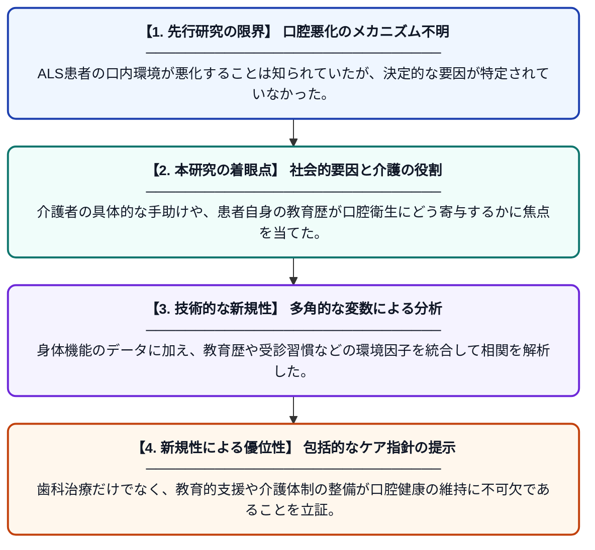

# 筋萎縮性側索硬化症（ALS）における口腔衛生と機能的歯列：介護者の関与、歯科受診、および教育歴の役割

**Original Title**: *Oral hygiene and functional dentition in amyotrophic lateral sclerosis: the roles of caregiver involvement, dental attendance, and educational attainment.*

> **💡 一言要約**: 介護と教育がALS患者の歯を守る鍵

| 項目 | 内容 |
|---|---|
| **著者** | CM Chen |
| **掲載誌** | 2026 |
| **アラートキーワード** | ALS |
| **PDF** | [https://jds.ads.org.tw/cgi/viewcontent.cgi?article=1233&context=articles_in_press](https://jds.ads.org.tw/cgi/viewcontent.cgi?article=1233&context=articles_in_press) |
| **原文リンク** | [https://jds.ads.org.tw/cgi/viewcontent.cgi?article=1233&context=articles_in_press](https://jds.ads.org.tw/cgi/viewcontent.cgi?article=1233&context=articles_in_press) |
| **PDF版要約** | [README.pdf](./README.pdf) |

---

## 📊 新規性の図解（先行研究との違いと本研究のブレークスルー）

## 📝 要約

ALS患者の進行する身体・口腔機能障害が口腔の健康に及ぼす影響を調査した研究です。介護者の積極的な関与、定期的な歯科受診、そして患者の教育歴が、良好な口腔衛生と歯の維持に重要な要因であることが示されました。

## ❓ どんな問題に取り組んだか

ALS患者は筋力の低下により自分で歯を磨くことが困難になり、口腔内が不衛生になりやすいという課題があります。しかし、どのような社会的・個人的要因が口腔環境の維持や悪化に具体的に関わっているのかは十分に解明されていませんでした。

## ✨ 何が新しい？何がすごい？（新規性）

本研究は、ALS患者の口腔状態を単に測定するだけでなく、介護者の関与度や教育歴といった社会的決定要因が口腔健康に与える影響を多角的に分析した点に新規性があります。特に、教育水準が高いほど機能的な歯列（噛める状態の歯）を維持しやすいという相関関係を明らかにし、社会的背景が難病患者のQOL（生活の質）に直結することを示しました。これにより、臨床的な歯科治療だけでなく、社会経済的な支援が難病ケアにおいて重要であることを浮き彫りにしました。

## 🎓 大学1年生向けの解説

ALSという、全身の筋肉が動かなくなる病気になると、自分で歯を磨くことが非常に難しくなります。この研究では、そんな患者さんがどうすればお口の健康を保てるかを調べました。その結果、周りの人が手伝ってくれることや、定期的にはいしゃさんに行くことがとても大切だと分かりました。さらに、その人が受けてきた教育の長さも、将来の歯の残り方に関係しているという意外な発見もありました。病気になってもおいしく食べるためには、周りの手助けと知識が必要だということを教えてくれる論文です。
