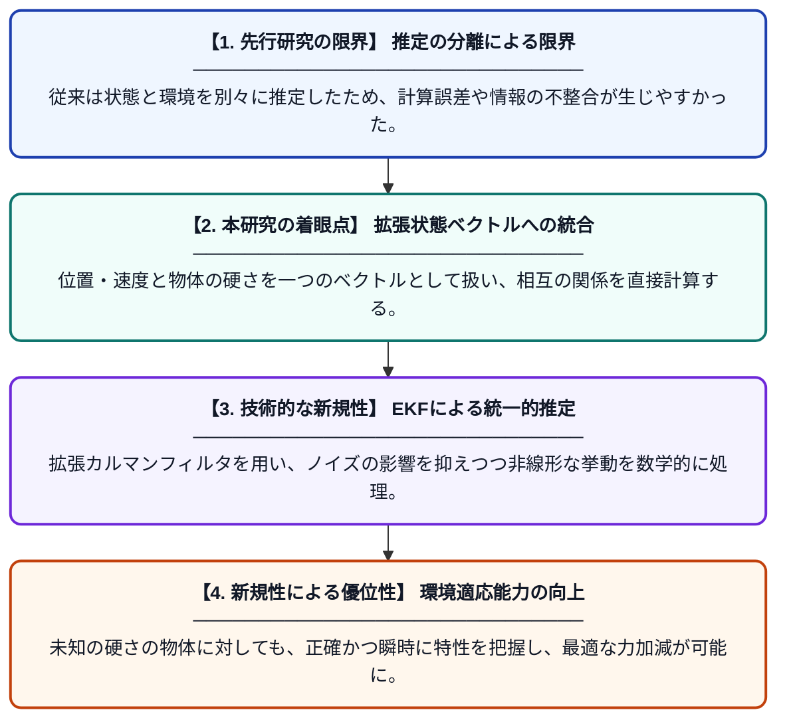

# 拡張カルマンフィルタを用いた状態と環境インピーダンスの同時推定への統一的アプローチ

**Original Title**: *A Unified Approach to Simultaneous Estimation of State and Environmental Impedance using Extended Kalman Filter*

> **💡 一言要約**: EKFで状態と環境の硬さを高精度に同時推定

| 項目 | 内容 |
|---|---|
| **著者** | A Takakura, M Otsuka, T Nozaki, S Adachi |
| **掲載誌** | SICE Festival with Annual … 2026 |
| **アラートキーワード** | kalman filter |
| **原文リンク** | [https://ieeexplore.ieee.org/abstract/document/11739248/](https://ieeexplore.ieee.org/abstract/document/11739248/) |
| **PDF版要約** | [README.pdf](./README.pdf) |

---

## 📊 新規性の図解（先行研究との違いと本研究のブレークスルー）

## 📝 要約

ロボットなどの制御対象の状態量と、接触対象である環境のインピーダンス特性を拡張カルマンフィルタ（EKF）を用いて同時に推定する手法を提案しています。従来手法である逐次最小二乗法などと比較し、カルマンフィルタに基づく統一的な枠組みで一括推定を行うことで、高精度な環境適応制御の実現を目指しています。

## ❓ どんな問題に取り組んだか

ロボットが未知の環境と接触する際、対象の硬さ（剛性）や摩擦（粘性）を正確に把握する必要がありますが、これらはロボットの位置や速度と密接に関係しており、別々に推定すると計算上の誤差が生じやすい課題がありました。また、実環境におけるノイズに対して安定かつ高速にこれらを推定する手法が求められていました。

## ✨ 何が新しい？何がすごい？（新規性）

本研究の新規性は、従来別々の枠組みで扱われることが多かった「状態推定」と「環境パラメータ同定」を、拡張カルマンフィルタ（EKF）という単一の再帰的フィルタリングの枠組みに統合した点にあります。先行研究の逐次最小二乗法（RLS）に比べ、統計的な最適性を考慮しながら一括推定を行うことで、観測ノイズに対するロバスト性が向上しています。EKFの特性を活かし、非線形システムに対しても適用可能な汎用性の高い同時推定アルゴリズムを確立したことが主要な貢献です。

## 🎓 大学1年生向けの解説

ロボットが壁を押したり物に触れたりするとき、その物が「どのくらい硬いか」を瞬時に知ることは、壊さないように優しく動くためにとても重要です。この論文では、ロボットの今の動き（場所やスピード）と、触っている物の硬さを、一つの数式でまとめて当てる「カルマンフィルタ」という魔法のような計算方法を提案しています。これまでの別々に計算する方法よりも、ノイズに強く正確に予想できるのが特徴です。これにより、初めて触る物体に対してもロボットが器用に動けるようになります。
