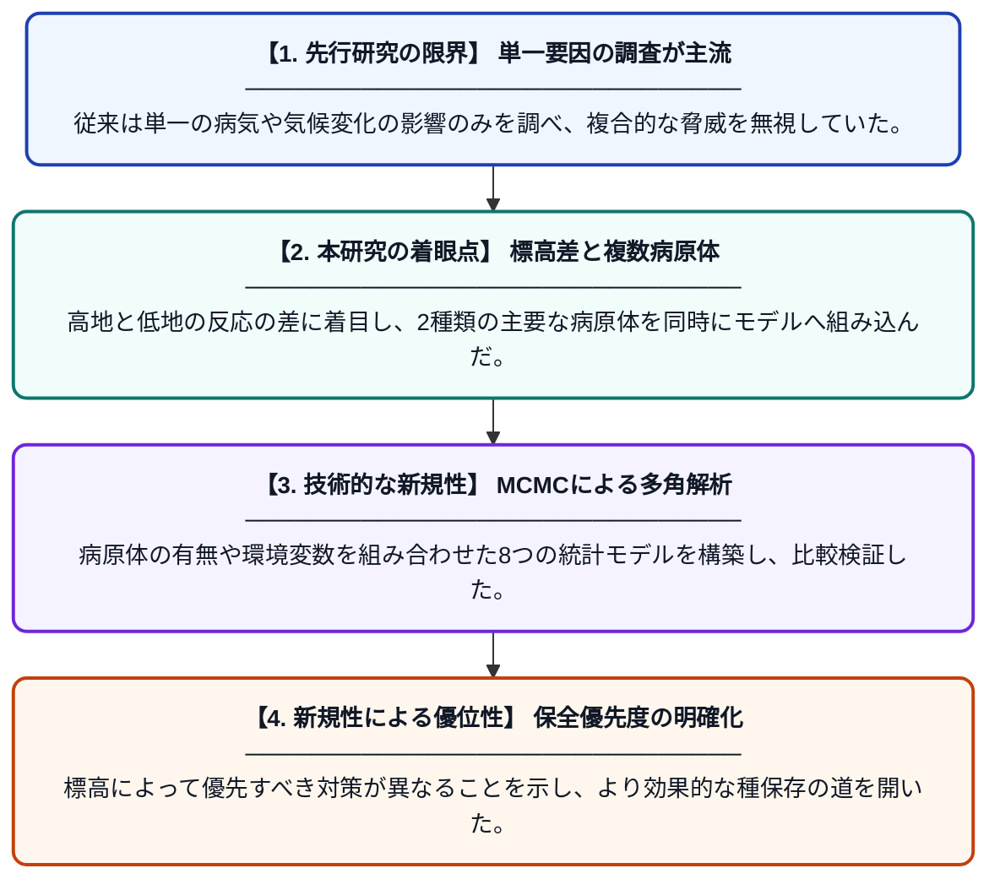

# 階段の上と下：気候変動と新興感染症に対する低地と高地の両生類コミュニティの対照的な反応

**Original Title**: *Upstairs, downstairs: contrasting responses of lowland and highland amphibian communities to climate change and emerging infectious diseases*

> **💡 一言要約**: 高地と低地で異なる！両生類を襲う気候変動と病気の二重苦

| 項目 | 内容 |
|---|---|
| **著者** | J Bosch, B Thumsová, A Díaz-Guerra, Á Rubio |
| **掲載誌** | Amphibia-Reptilia 2026 |
| **アラートキーワード** | MCMC |
| **原文リンク** | [https://brill.com/view/journals/amre/aop/article-10.1163-15685381-bja10275/article-10.1163-15685381-bja10275.xml](https://brill.com/view/journals/amre/aop/article-10.1163-15685381-bja10275/article-10.1163-15685381-bja10275.xml) |
| **PDF版要約** | [README.pdf](./README.pdf) |

---

## 📊 新規性の図解（先行研究との違いと本研究のブレークスルー）

## 📝 要約

この研究は、気候変動と2種類の新興感染症（カエルツボカビとラナウイルス）が、低地と高地の両生類コミュニティに与える影響を比較したものです。8つの統計モデルを用いた解析により、標高の違いによってこれらの脅威に対する両生類の反応が大きく異なることを明らかにしました。

## ❓ どんな問題に取り組んだか

両生類は気候変動と感染症という複数の脅威にさらされていますが、これらが異なる標高の生息地においてどのように相互作用し、群集全体に影響を与えるのかは十分に解明されていませんでした。特に複数の病原体が同時に存在する場合の影響評価が不足していました。

## ✨ 何が新しい？何がすごい？（新規性）

本研究は、低地と高地の両生類群集を直接比較し、環境要因と複数の病原体（BdとRv）の組み合わせをMCMCモデルで精緻に解析した点が画期的です。単一の要因ではなく、複数の脅威が標高ごとに異なるパターンで群集構造を変化させることを数理的に示しました。これにより、特定の環境下でどの脅威が支配的になるかを特定する新しい枠組みを提示しました。

## 🎓 大学1年生向けの解説

カエルやサンショウウオなどの両生類は、今、地球温暖化と恐ろしい感染症のせいで絶滅の危機にあります。この研究では、山の上に住むグループと低い土地に住むグループで、これらの影響にどのような違いがあるかを調べました。その結果、住む場所の高さによって、病気の広がり方や温暖化へのダメージの受け方が全く違うことがわかりました。この発見は、それぞれの場所に合わせて、どのように生き物を守るべきかを考えるための重要なヒントになります。
