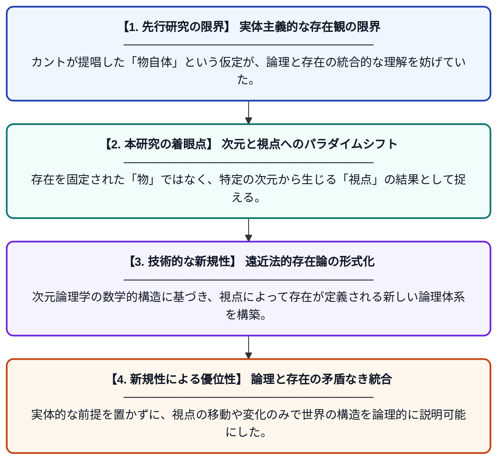

# 遠近法的存在論と次元論理学

**Original Title**: *Perspective Ontology and Dimensional Logic*

> **💡 一言要約**: 物自体を否定し、視点から存在を再定義する新論理学

| 項目 | 内容 |
|---|---|
| **著者** | W Stegemann |
| **掲載誌** | 2026 |
| **アラートキーワード** | Ontology |
| **原文リンク** | [https://philpapers.org/rec/STEPOA-13](https://philpapers.org/rec/STEPOA-13) |
| **PDF版要約** | [README.pdf](./README.pdf) |

---

## 📊 新規性の図解（先行研究との違いと本研究のブレークスルー）

## 📝 要約

カントの「物自体」という概念を批判し、次元論理学（Stegemann, 2025a）の基礎となる存在論を構築する研究です。実体主義的なリアリズムを脱却し、存在を視点や次元に基づいた構造として捉え直す新しい哲学の枠組みを提案しています。

## ❓ どんな問題に取り組んだか

従来の哲学では、認識とは独立して存在する「物自体」を想定する傾向がありました。しかし、この実体的な考え方は、論理的な形式と実際の存在のあり方を矛盾なく統合して説明する上で大きな壁となっていました。

## ✨ 何が新しい？何がすごい？（新規性）

カントの物自体という伝統的な概念を拒絶し、存在を固定的な実体ではなく「次元」や「視点」の相互作用として定義した点が極めて独創的です。前著で示された次元論理学の数理的な形式に対し、存在論という哲学的な「肉付け」を行うことで、理論の完成度を高めています。これにより、認識の主観性と世界の客観性を架橋する新しい論理体系の基盤を確立しました。

## 🎓 大学1年生向けの解説

「リンゴをどの角度から見るかによって形が違って見える」ということを想像してみてください。この論文は、世の中のすべての存在は、このような「見る視点（次元）」によって決まると考える新しい哲学について書かれています。昔の偉い哲学者カントは「私たちがどう見ても変わらない本当の姿がある」と言いましたが、著者はそれを否定して、視点そのものが存在を作るという大胆な考え方を提案しています。少し難しいですが、私たちの認識の仕組みを根本から作り直そうとする挑戦的な研究です。
