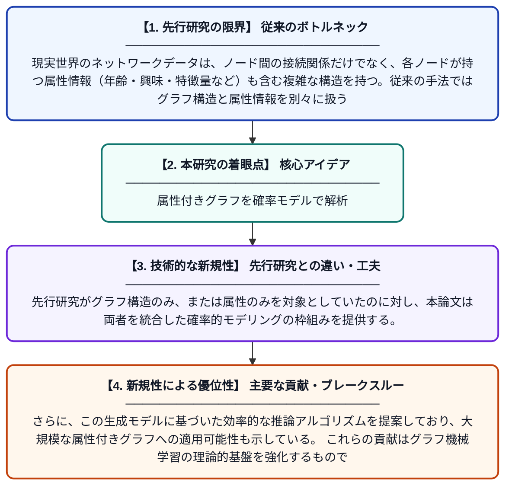

# 属性付きグラフのモデリングと推論に関する研究

**Original Title**: *MODELING AND INFERRING ATTRIBUTED GRAPHS A Dissertation*

> **💡 一言要約**: 属性付きグラフを確率モデルで解析

| 項目 | 内容 |
|---|---|
| **著者** | J Jia |
| **アラートキーワード** | MRFs Markov |
| **原文リンク** | [https://ecommons.cornell.edu/server/api/core/bitstreams/10bff426-184a-42a2-87e1-008d8e155e85/content](https://ecommons.cornell.edu/server/api/core/bitstreams/10bff426-184a-42a2-87e1-008d8e155e85/content) |
| **PDF版要約** | [README.pdf](./README.pdf) |

---

## 📊 新規性の図解（先行研究との違いと本研究のブレークスルー）

## 📝 要約

本論文は、ノードに属性情報を持つグラフ（属性付きグラフ）を確率的にモデル化・推論するための手法を提案する。マルコフ確率場（MRF）をベースとした生成モデル、特にガウス型マルコフ確率場を用いることで、グラフ構造とノード属性の相互依存関係を統一的に扱う枠組みを構築している。これにより、グラフデータからの効率的な統計的推論が可能となる。

## ❓ どんな問題に取り組んだか

現実世界のネットワークデータは、ノード間の接続関係だけでなく、各ノードが持つ属性情報（年齢・興味・特徴量など）も含む複雑な構造を持つ。従来の手法ではグラフ構造と属性情報を別々に扱うことが多く、両者の相互作用を統一的にモデル化することが困難であった。このギャップを埋める理論的かつ実用的な枠組みが求められていた。

## ✨ 何が新しい？何がすごい？（新規性）

本研究はマルコフ確率場（MRF）をグラフの生成モデルとして採用し、特にガウス型MRFを用いることでノードの属性とグラフ構造を同時にモデル化する点が新しい。先行研究がグラフ構造のみ、または属性のみを対象としていたのに対し、本論文は両者を統合した確率的モデリングの枠組みを提供する。さらに、この生成モデルに基づいた効率的な推論アルゴリズムを提案しており、大規模な属性付きグラフへの適用可能性も示している。これらの貢献はグラフ機械学習の理論的基盤を強化するものである。

## 🎓 大学1年生向けの解説

SNSやウェブサイトのリンク構造のように、点（ノード）と線（エッジ）でできたデータを「グラフ」と呼びます。さらに各点が「年齢」や「趣味」などの情報（属性）を持つ場合、それを「属性付きグラフ」といいます。この論文では、そのような複雑なデータをマルコフ確率場という数学的な道具を使って確率的に表現し、データから有益な情報を取り出す方法を研究しています。たとえば、友達のグループを自動的に発見したり、欠けている情報を補完したりすることに役立ちます。
