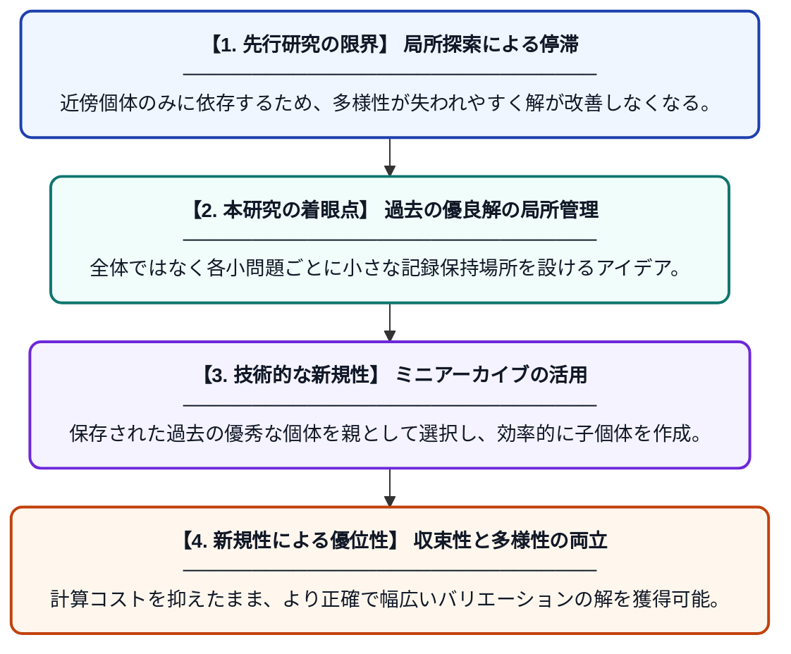

# 分解型多目的進化最適化における局所ミニアーカイブを用いた選択と生殖の効率向上

**Original Title**: *Improving selection and reproduction efficiency by exploiting local mini-archives in the decomposition-based evolutionary multi-objective optimization*

> **💡 一言要約**: ミニ記録庫で最適化の効率と質を両立

| 項目 | 内容 |
|---|---|
| **著者** | MK Tomczyk |
| **掲載誌** | Swarm and Evolutionary Computation 2026 |
| **アラートキーワード** | optimization |
| **原文リンク** | [https://www.sciencedirect.com/science/article/pii/S2210650226003329](https://www.sciencedirect.com/science/article/pii/S2210650226003329) |
| **PDF版要約** | [README.pdf](./README.pdf) |

---

## 📊 新規性の図解（先行研究との違いと本研究のブレークスルー）

## 📝 要約

分解ベースの進化型多目的最適化（MOEA/D等）において、各部分問題に「局所ミニアーカイブ」を導入することで、親の選択と子の生成プロセスを改善する手法を提案しています。この仕組みにより、探索の停滞を防ぎつつ、解の収束性と多様性を効率的に高めることが可能になりました。

## ❓ どんな問題に取り組んだか

従来の分解ベースの手法では、近傍の個体のみを親として利用するため、探索が局所的な範囲に固執して多様性が失われる課題がありました。また、進化の過程で得られた過去の優れた情報が十分に活用されず、解の改善が停滞しやすいという問題も存在しました。

## ✨ 何が新しい？何がすごい？（新規性）

本研究の革新性は、各部分問題に紐付いた小規模な「局所ミニアーカイブ」を導入し、過去の優良解を効率的に再利用する点にあります。全体を管理する巨大なアーカイブとは異なり、特定の探索領域に適した情報を保持することで、計算負荷を抑えながら高品質な子個体の生成を促進します。これにより、進化プロセスにおける「選択」と「生殖」の質を同時に向上させるという独自の貢献を果たしています。

## 🎓 大学1年生向けの解説

この研究は、例えば「安くて、軽くて、丈夫な自転車」のように、複数の目標を同時に叶える最高の組み合わせを見つけるための計算方法を改良したものです。これまでは「今のチームメンバー」の中だけで相談して新しい案を作っていましたが、この方法では「過去の優秀なアイデア」を小さなメモ帳（ミニアーカイブ）に残しておきます。そのメモを参考にすることで、行き詰まることなく、より優れたアイデアを効率よく生み出せるようになります。
