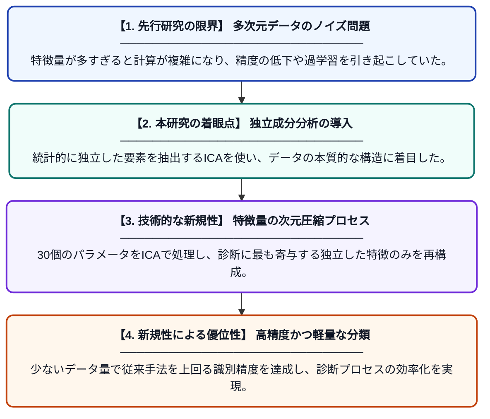

# 特徴量削減表現を用いた乳がん検出

**Original Title**: *Breast Cancer Detection Using Reduced Feature Representation*

> **💡 一言要約**: ICAで重要な情報を抽出し乳がん診断をより正確に

| 項目 | 内容 |
|---|---|
| **著者** | TS Chakravarthy, T Tejasri, T Bharath, S Pranitha… |
| **掲載誌** | 2026 |
| **アラートキーワード** | independent component ... |
| **PDF** | [https://ijsrem.com/download/breast-cancer-detection-using-reduced-feature-representation/fulltext.pdf](https://ijsrem.com/download/breast-cancer-detection-using-reduced-feature-representation/fulltext.pdf) |
| **原文リンク** | [https://ijsrem.com/download/breast-cancer-detection-using-reduced-feature-representation/fulltext.pdf](https://ijsrem.com/download/breast-cancer-detection-using-reduced-feature-representation/fulltext.pdf) |
| **PDF版要約** | [README.pdf](./README.pdf) |

---

## 📊 新規性の図解（先行研究との違いと本研究のブレークスルー）

## 📝 要約

独立成分分析（ICA）を特徴量削減手法として採用し、乳がん分類の精度向上と効率化を検証した研究です。30個の変数を持つWDBCデータセットを用い、統計的に独立な成分を抽出することで、診断に真に必要な情報を特定しています。

## ❓ どんな問題に取り組んだか

乳がん診断用のデータセットは多次元で複雑なため、計算コストの増大や過学習が課題となっていました。不要な特徴量がノイズとなり、AIモデルが病変の本質的な特徴を捉えきれないことが精度の限界を招いていました。

## ✨ 何が新しい？何がすごい？（新規性）

従来多用されていた主成分分析（PCA）ではなく、データの独立性を最大化する独立成分分析（ICA）を特徴量削減に適用した点が革新的です。ICAは非ガウス的な信号を分離する能力に優れており、医療データに含まれる微細かつ独立した生物学的特徴を抽出することに成功しました。このアプローチにより、次元を大幅に圧縮しながらも、分類に必要な情報の損失を最小限に抑えています。

## 🎓 大学1年生向けの解説

乳がんの検査結果にはたくさんの項目がありますが、実はその中には診断に関係のない「ノイズ」も混ざっています。この研究では、複雑なデータの中から「がんかどうかの決め手」となる純粋な情報だけを取り出す魔法のような数学の手法（ICA）を使いました。情報をダイエットさせてスッキリさせることで、コンピューターが迷わずに、より正確で素早く診断を下せるようになります。
