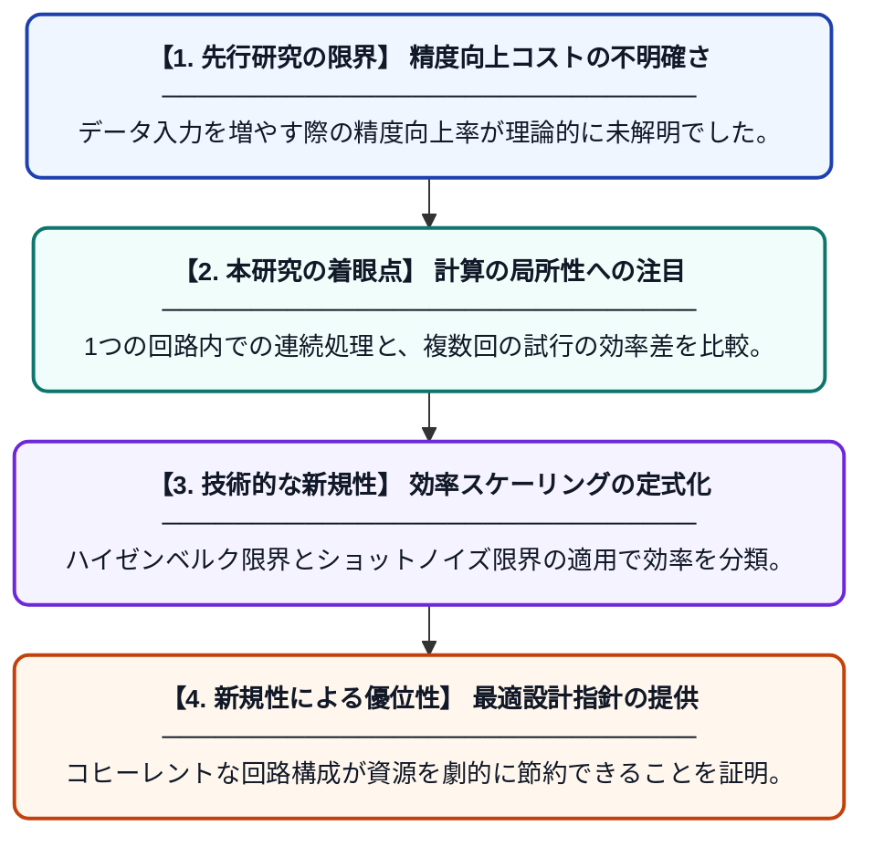

# 量子モデルにおけるデータ・エンコーディングの非線形性とそのコスト

**Original Title**: *Quantum models pay for non-linearity in data encodings*

> **💡 一言要約**: 効率的な量子学習の鍵はコヒーレンスにあり

| 項目 | 内容 |
|---|---|
| **著者** | P Sulimov, C Lehmann |
| **掲載誌** | 2026 |
| **アラートキーワード** | one shot |
| **原文リンク** | [https://www.researchsquare.com/article/rs-11614879/latest](https://www.researchsquare.com/article/rs-11614879/latest) |
| **PDF版要約** | [README.pdf](./README.pdf) |

---

## 📊 新規性の図解（先行研究との違いと本研究のブレークスルー）

## 📝 要約

量子回路でデータをエンコードする際、計算資源を1回の試行（ショット）内に集中させるか、複数の試行に分散させるかで解像度の向上効率が劇的に変わることを解明した論文です。コヒーレントな回路内での処理はハイゼンベルク限界の効率を実現しますが、分散させた場合は効率が二乗で低下することを理論的に示しました。

## ❓ どんな問題に取り組んだか

量子機械学習ではデータの非線形性を表現するために複数回のデータ入力（エンコーディング）が必要ですが、その入力回数が精度にどう寄与するかは不明確でした。特に、回路の深さを増やすべきか、測定回数を増やすべきかという設計指針が不足していました。

## ✨ 何が新しい？何がすごい？（新規性）

エンコーディングの範囲を1ショット内に収めることで、データの解像度がハイゼンベルク限界に従って線形に向上することを証明しました。対照的に、複数のショットにエンコーディングを分散させるハイブリッドモデルでは、同等の精度を得るために二乗倍の計算資源が必要になることを特定しました。これにより、量子回路の「深さ」と「試行回数」のトレードオフを理論的に確立しました。

## 🎓 大学1年生向けの解説

量子コンピュータでデータを扱う際、同じ情報を何度も「入力」して複雑な計算を行います。この研究では、入力を1回の長い計算にまとめるのと、短い計算を何度も繰り返すのでは、効率が全く違うことを発見しました。1回にまとめた方が、データの細かい変化をより少ない入力回数で捉えることができます。これは、将来の量子AIをより少ない資源で動かすための重要な手がかりになります。
