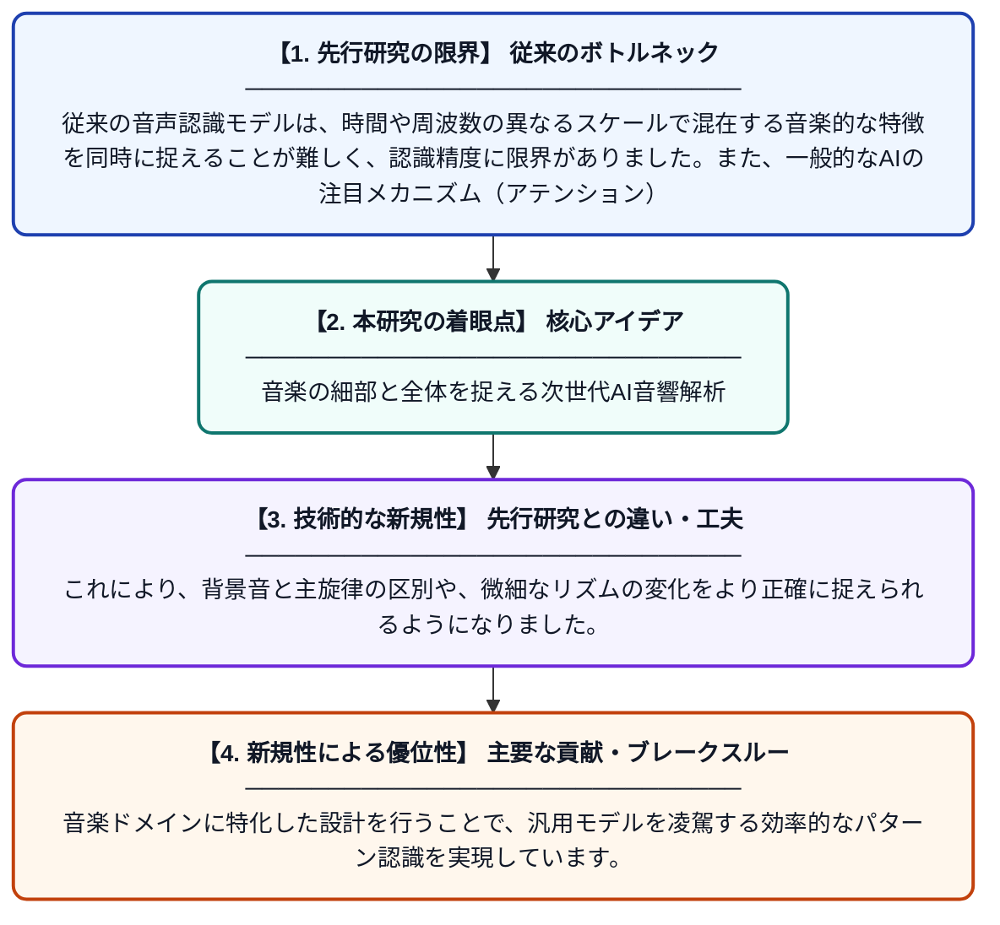

# マルチスケール分光図表現学習と適応型アテンション最適化による、音楽を考慮した知的オーディオパターン認識のためのトランスフォーマー・フレームワーク

**Original Title**: *A music-aware transformer framework with multi-scale spectrogram representation learning and adaptive attention optimization for intelligent audio pattern recognition*

> **💡 一言要約**: 音楽の細部と全体を捉える次世代AI音響解析

| 項目 | 内容 |
|---|---|
| **著者** | Y Chen, KH Alkhater, A Al-Daher, N Mohan… |
| **掲載誌** | Complex & Intelligent … 2026 |
| **アラートキーワード** | representation learning |
| **原文リンク** | [https://link.springer.com/article/10.1007/s40747-026-02557-0](https://link.springer.com/article/10.1007/s40747-026-02557-0) |
| **PDF版要約** | [README.pdf](./README.pdf) |

---

## 📊 新規性の図解（先行研究との違いと本研究のブレークスルー）

## 📝 要約

本研究は、音楽の構造を深く理解するために設計された新しいトランスフォーマー・フレームワークを提案しています。マルチスケールの分光図学習と適応型アテンション機構を組み合わせることで、複雑な音声パターンを高精度に識別することが可能になりました。

## ❓ どんな問題に取り組んだか

従来の音声認識モデルは、時間や周波数の異なるスケールで混在する音楽的な特徴を同時に捉えることが難しく、認識精度に限界がありました。また、一般的なAIの注目メカニズム（アテンション）では、音楽特有の重要な変化に柔軟に対応できないという課題もありました。

## ✨ 何が新しい？何がすごい？（新規性）

この論文の革新性は、音を異なる解像度で同時に分析する「マルチスケール表現学習」と、状況に応じて注目箇所を自動調整する「適応型アテンション」を統合した点にあります。これにより、背景音と主旋律の区別や、微細なリズムの変化をより正確に捉えられるようになりました。音楽ドメインに特化した設計を行うことで、汎用モデルを凌駕する効率的なパターン認識を実現しています。

## 🎓 大学1年生向けの解説

音楽をAIで分析するのは非常に難しい挑戦です。なぜなら、音には「一瞬の響き」と「曲全体の流れ」の両方が重要だからです。この研究では、音を虫眼鏡で見るような細かい分析と、地図を見るような全体的な分析を同時に行えるAIを作りました。このAIは、人間が曲の重要な部分に耳を傾けるように、自動で大事な音に集中して聞き取ることができる画期的なシステムです。
