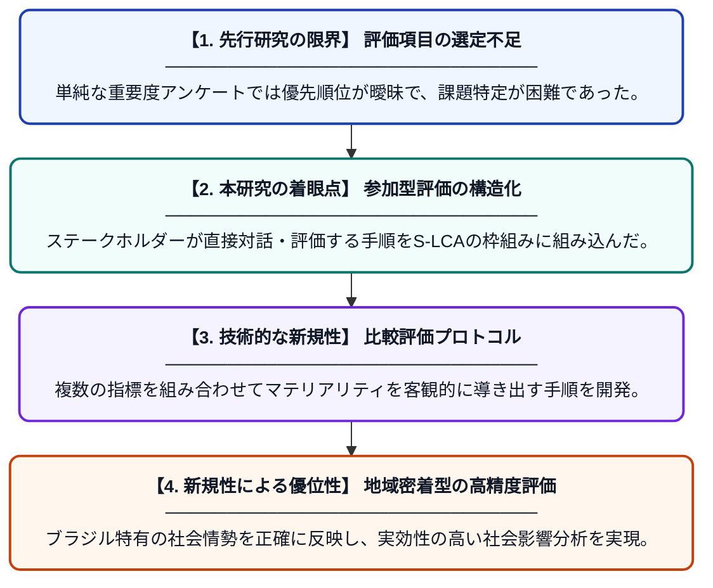

# ブラジル・バイーア州における包装容器の逆物流：S-LCAのマテリアリティ評価に資する参加型重要度格付け

**Original Title**: *Packaging reverse logistics in Bahia, Brazil: participatory importance ratings to inform materiality assessment in S-LCA*

> **💡 一言要約**: S-LCAの重要課題を参加型評価で科学的に特定

| 項目 | 内容 |
|---|---|
| **著者** | TLM de Castro Leal, AMRO Chabrawi, CML Ugaya… |
| **掲載誌** | Waste Management 2027 |
| **アラートキーワード** | logistics |
| **原文リンク** | [https://www.sciencedirect.com/science/article/pii/S0956053X26006616](https://www.sciencedirect.com/science/article/pii/S0956053X26006616) |
| **PDF版要約** | [README.pdf](./README.pdf) |

---

## 📊 新規性の図解（先行研究との違いと本研究のブレークスルー）

## 📝 要約

ブラジル・バイーア州の包装リサイクルを対象に、社会的ライフサイクルアセスメント（S-LCA）における重要課題（マテリアリティ）を特定する新しい手順を開発しました。ステークホルダーが参加する構造化された評価プロセスを通じて、単なる重要度の格付けを超えた、実効性のある課題選定手法を提案しています。

## ❓ どんな問題に取り組んだか

社会的ライフサイクルアセスメント（S-LCA）において、どの社会項目を優先的に評価すべきかという「マテリアリティ」の選定基準が不明確でした。従来のアンケートによる重要度評価だけでは、具体的かつ客観的な優先順位を導き出すには不十分であるという課題がありました。

## ✨ 何が新しい？何がすごい？（新規性）

本研究は、ブラジルの逆物流という複雑な現場において、ステークホルダーの参加を構造化した新しい重要度評価プロトコルを開発しました。単一の評価に頼らず、複数の視点を比較・統合することで、主観的な意見を客観的な評価項目へと変換するプロセスを確立しています。これにより、地域固有の社会的背景を反映しつつ、学術的妥当性を持つS-LCAのマテリアリティ特定が可能になりました。

## 🎓 大学1年生向けの解説

リサイクルなどの活動が社会に与える影響を調べる際、何を一番大事に考えるべきかを決めるのはとても難しい作業です。この研究では、ブラジルでリサイクルに関わる人たちの意見を整理して、本当に解決すべき社会問題を公平に見つけ出すための新しいルールを作りました。これを使うことで、専門家だけの判断ではなく、現場の声を生かしたより良い社会づくりに貢献できます。
