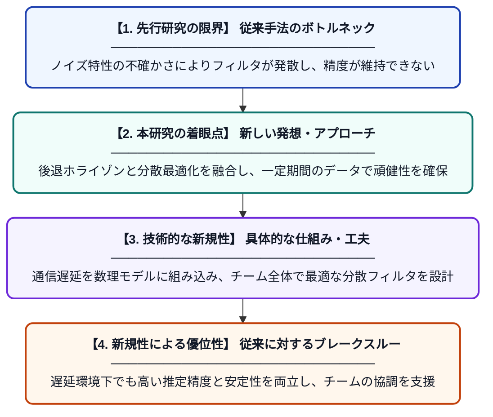

# 遅延を伴う離散マルチエージェントシステムのための後退ホライゾン・チーム最適分散フィルタ

**Original Title**: *Receding Horizon Team Optimal Decentralized Filter for Discrete Multi-agent Systems with Delay*

> **💡 一言要約**: 遅延と不確実性に強い、協調型エージェントフィルタ

| 項目 | 内容 |
|---|---|
| **著者** | X Li, J Liu, X Liu, H Guo, R Gao |
| **掲載誌** | 2026 |
| **アラートキーワード** | kalman filter |
| **PDF** | [https://media.sciltp.com/articles/2610005499/2610005499.pdf](https://media.sciltp.com/articles/2610005499/2610005499.pdf) |
| **原文リンク** | [https://media.sciltp.com/articles/2610005499/2610005499.pdf](https://media.sciltp.com/articles/2610005499/2610005499.pdf) |
| **PDF版要約** | [README.pdf](./README.pdf) |

---

## 📊 新規性の図解（先行研究との違いと本研究のブレークスルー）

## 📝 要約

ノイズの統計的性質が不明確な場合に標準的なカルマンフィルタが直面する発散問題を解決するため、新しい分散型フィルタを提案しています。通信遅延が存在するマルチエージェントシステムにおいて、有限時間の最適化を行う後退ホライゾンの考え方を導入し、チーム全体で最適な推定を実現します。

## ❓ どんな問題に取り組んだか

従来のカルマンフィルタは、ノイズの統計的な情報が正確でない場合に推定精度が著しく低下したり、計算が発散したりする課題がありました。特に、複数のエージェントが協力するシステムにおいて、通信の遅延が存在する中で安定かつ高精度な状態推定を行うことは困難でした。

## ✨ 何が新しい？何がすごい？（新規性）

本研究の最大の特徴は、後退ホライゾン（Receding Horizon）戦略をチーム最適な分散フィルタリングに統合した点にあります。先行研究では対応が難しかった「遅延があるマルチエージェント環境」に対し、有限の観測窓を用いることでモデルの不確かさへの耐性を高めました。これにより、個々のエージェントが独立して動くのではなく、チーム全体として最適な推定結果を得るための理論的枠組みを確立しました。

## 🎓 大学1年生向けの解説

複数のロボットがチームで動くとき、各ロボットは自分の位置を正確に知る必要があります。しかし、センサーの誤差や情報の伝達遅れがあると、計算が狂ってしまいます。この研究は、最新のデータだけでなく少し過去に遡ったデータも使い直すことで、情報の遅れや間違いに強い「チーム専用の計算ルール」を作りました。これによって、厳しい環境でもロボットたちが迷わずに協力できるようになります。
