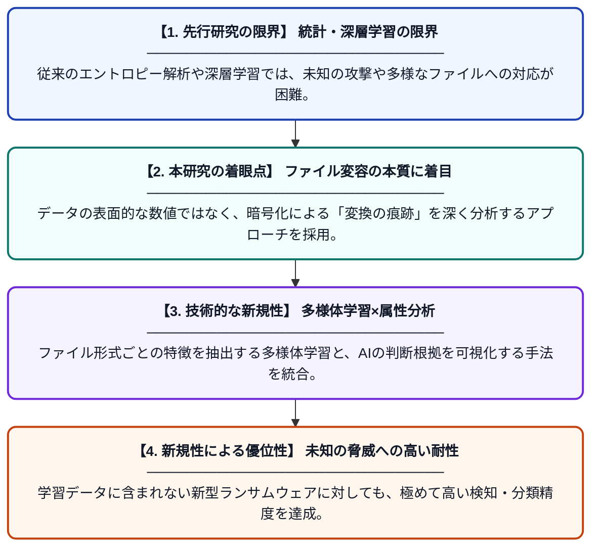

# VAFTD：ビッグデータ環境における未知のランサムウェア分類のための多様性を考慮したフォレンジック変換検知

**Original Title**: *VAFTD: Variety-Aware Forensic Transformation Detection for Zero-Shot Ransomware Classification in Big Data Environments*

> **💡 一言要約**: 未知の脅威を逃さない！変幻自在なランサムウェア検知

| 項目 | 内容 |
|---|---|
| **著者** | NS Sneha, S Prabhu |
| **掲載誌** | IEEE International Conference on Distributed … 2026 |
| **アラートキーワード** | manifold learning |
| **原文リンク** | [https://ieeexplore.ieee.org/abstract/document/11766384/](https://ieeexplore.ieee.org/abstract/document/11766384/) |
| **PDF版要約** | [README.pdf](./README.pdf) |

---

## 📊 新規性の図解（先行研究との違いと本研究のブレークスルー）

## 📝 要約

多様なファイル形式が存在するビッグデータ環境において、未知のランサムウェアを精度高く分類する新手法「VAFTD」を提案しています。ファイルの種類に応じた多様体学習とニューラル属性分析を統合することで、従来のエントロピーベースの手法や一般的な深層学習が抱えていた検知の限界を克服しました。

## ❓ どんな問題に取り組んだか

従来のランサムウェア検知はエントロピー解析や標準的な深層学習に依存しており、未知の攻撃手法や多様なファイル形式に対して精度が低下する課題がありました。特に大規模なデータ環境では、ファイルの種類によって暗号化の痕跡が異なるため、汎用的な検知モデルの構築が困難でした。

## ✨ 何が新しい？何がすごい？（新規性）

本研究の最大の特徴は、ファイルタイプ別の「多様体学習」と「ニューラル属性」を組み合わせたハイブリッドアプローチにあります。これにより、単なる統計値の比較ではなく、暗号化プロセスによる「データの幾何学的な変容」を捉えることが可能になりました。この結果、一度も学習していない新型のランサムウェア（ゼロショット）に対しても、極めて高い堅牢性と分類精度を実証しています。

## 🎓 大学1年生向けの解説

ランサムウェアは、大切なファイルを勝手に暗号化して「元に戻してほしければ金を払え」と脅すウイルスですが、犯人は次々と新しい攻撃方法を編み出します。この研究は、AIを使って「ファイルがどのように書き換えられたか」という深い特徴を見抜くことで、これまでに見たことがない最新の攻撃でも一瞬で判別できるようにしました。たとえ写真や文章、動画などバラバラな種類のファイルが混ざっていても、その中に隠された「攻撃の跡」を正確に見つけることができます。
