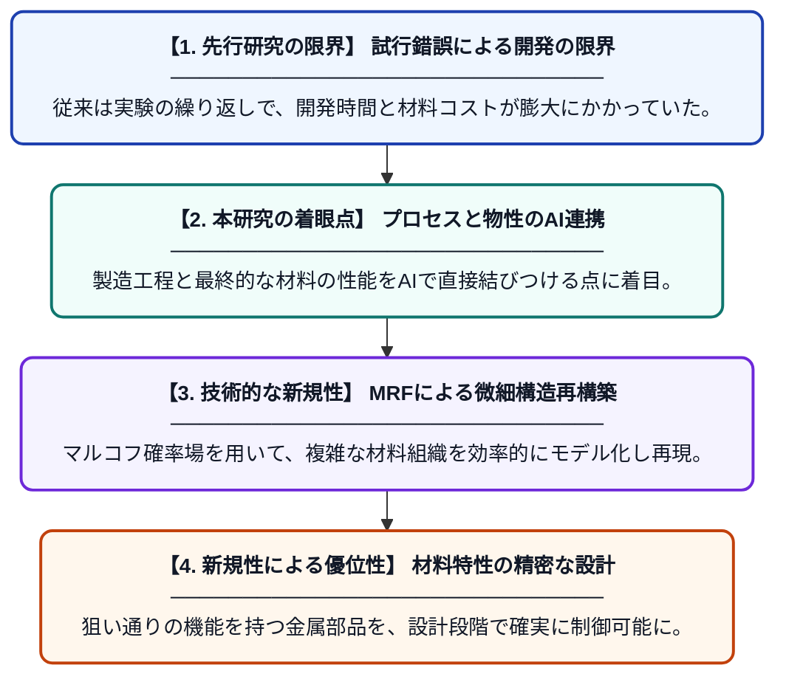

# プロセスからプログラム可能な特性へ：金属加法製造における人工知能のレビュー

**Original Title**: *From Processing to Programmable Properties: A Review of Artificial Intelligence in Metal Additive Manufacturing*

> **💡 一言要約**: AIで金属3Dプリントの特性を自在に設計する

| 項目 | 内容 |
|---|---|
| **著者** | D Sanpui, S Manna, SKRS Sankaranarayanan |
| **掲載誌** | 2026 |
| **アラートキーワード** | Markov random"  fields |
| **PDF** | [https://chemrxiv.org/doi/pdf/10.26434/chemrxiv.15011182](https://chemrxiv.org/doi/pdf/10.26434/chemrxiv.15011182) |
| **原文リンク** | [https://chemrxiv.org/doi/pdf/10.26434/chemrxiv.15011182](https://chemrxiv.org/doi/pdf/10.26434/chemrxiv.15011182) |
| **PDF版要約** | [README.pdf](./README.pdf) |

---

## 📊 新規性の図解（先行研究との違いと本研究のブレークスルー）

## 📝 要約

金属3Dプリンティング（加法製造）におけるAI技術の活用を包括的にレビューした論文です。製造プロセスから微細構造の再構築、最終的な材料特性の制御まで、AIがいかにして「望みの特性」をプログラム可能にするかを体系的に解説しています。

## ❓ どんな問題に取り組んだか

金属3Dプリントは熱影響や材料の変化が複雑で、製造後の強度や品質を正確に予測・制御することが極めて困難でした。従来の試行錯誤的な手法では、新しい材料や複雑な形状の設計に膨大な時間とコストがかかるという課題がありました。

## ✨ 何が新しい？何がすごい？（新規性）

単なる工程の最適化を超え、マルコフ確率場（MRF）を用いた微細構造の再構築など、高度なAIモデルを統合した点が画期的です。製造プロセス、微細構造、材料特性の相関をAIで結びつけることで、材料特性を「後から決まるもの」ではなく「設計時にプログラムするもの」へと進化させました。

## 🎓 大学1年生向けの解説

金属を積み上げて形を作る「金属3Dプリンター」は、熱の伝わり方などで完成品の強さがバラバラになりやすいのが弱点でした。この論文は、AIを使って材料のミクロな構造をシミュレーションし、欲しい性能をあらかじめ計算して作る方法を紹介しています。まるで料理のレシピをAIが調整して、誰でも最高の味（品質）を安定して作れるようにする技術のまとめです。
