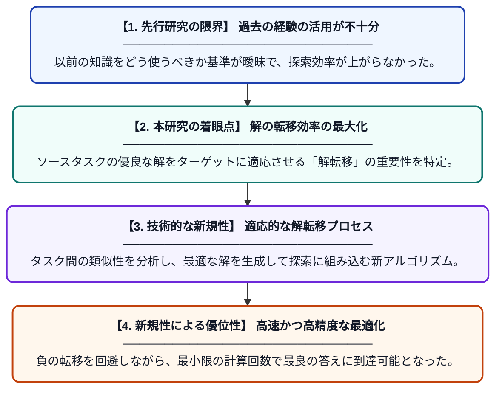

# 進化的逐次転移最適化のための効果的な解転移に向けて

**Original Title**: *Toward Effective Solution Transfer for Evolutionary Sequential Transfer Optimization*

> **💡 一言要約**: 過去の経験を賢く引き継ぎ、最適化を劇的に高速化する

| 項目 | 内容 |
|---|---|
| **著者** | W Lin, W Chen, S Liu, Q Lin, L Feng, KC Tan |
| **掲載誌** | IEEE Transactions on Evolutionary … 2026 |
| **アラートキーワード** | optimization |
| **原文リンク** | [https://ieeexplore.ieee.org/abstract/document/11803025/](https://ieeexplore.ieee.org/abstract/document/11803025/) |
| **PDF版要約** | [README.pdf](./README.pdf) |

---

## 📊 新規性の図解（先行研究との違いと本研究のブレークスルー）

## 📝 要約

過去の最適化タスクで得られた知識を新しいタスクに引き継ぐ「進化的逐次転移最適化（ESTO）」において、より効率的な解の転移手法を提案しています。ソースタスクからターゲットタスクへ知識を移す際の精度を向上させることで、複雑な問題に対する計算コストの削減と探索能力の強化を実現しました。

## ❓ どんな問題に取り組んだか

従来の進化的アルゴリズムは、新しい問題に直面するたびにゼロから探索を開始するため、計算資源が無駄になるという課題がありました。関連する過去のタスクから知識を転移する手法も存在しますが、何をどのように転移すべきかという基準が不明確で、逆に性能が悪化する「負の転移」が頻発していました。

## ✨ 何が新しい？何がすごい？（新規性）

本研究は、ESTOにおける「解の転移」のメカニズムを抜本的に再設計し、タスク間の相関を動的に評価して有用な情報のみを抽出する新しいフレームワークを提案しました。従来の静的な知識コピーとは異なり、ターゲットタスクの探索状況に合わせて最適な解の候補を適応的に生成・導入する点が独創的です。これにより、無関係なタスクからの干渉を最小限に抑えつつ、収束速度を飛躍的に高めることに成功しました。

## 🎓 大学1年生向けの解説

難しいパズルを解くとき、以前似たようなパズルを解いたことがあれば、その時のコツを使って早く解けるはずです。この研究は、コンピュータ（AI）が過去に解いた問題の「正解のパターン」を学習し、それを新しい似た問題に上手に当てはめる方法を作ったものです。これまでは、以前の経験を無理に使おうとして逆に混乱することもありましたが、この新しい方法では「本当に役立つヒント」だけを選んで使えるようになり、AIがより速く正確に答えを出せるようになりました。
