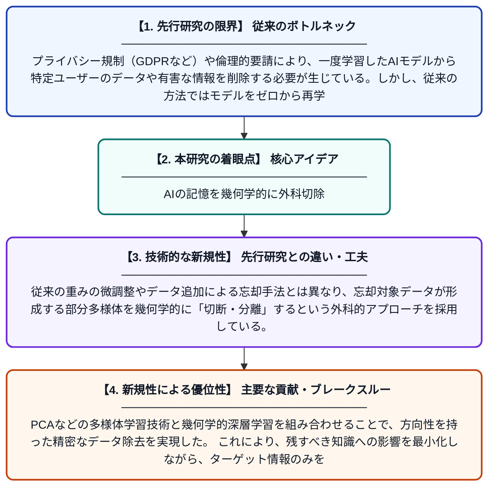

# メモリ多様体手術による機械的忘却：低次元部分多様体の切断を通じた方向的データ除去

**Original Title**: *Machine Unlearning via Memory Manifold Surgery: Directional Data Elimination through Low-Dimensional Submanifold Disconnection*

> **💡 一言要約**: AIの記憶を幾何学的に外科切除

| 項目 | 内容 |
|---|---|
| **著者** | J Zhang |
| **アラートキーワード** | manifold learning |
| **PDF** | [https://openreview.net/pdf?id=U9knNhPZyo](https://openreview.net/pdf?id=U9knNhPZyo) |
| **原文リンク** | [https://openreview.net/pdf?id=U9knNhPZyo](https://openreview.net/pdf?id=U9knNhPZyo) |
| **PDF版要約** | [README.pdf](./README.pdf) |

---

## 📊 新規性の図解（先行研究との違いと本研究のブレークスルー）

## 📝 要約

本論文は、学習済みAIモデルから特定のデータの影響を消去する「機械的忘却（Machine Unlearning）」の新手法を提案する。高次元のデータ空間が実際には低次元の多様体構造を持つという幾何学的視点を活用し、忘却対象データに対応する部分多様体を「切断」することで効率的にその影響を除去する。これにより、モデル全体を再学習することなく、特定情報を選択的かつ精確に消去することが可能になる。

## ❓ どんな問題に取り組んだか

プライバシー規制（GDPRなど）や倫理的要請により、一度学習したAIモデルから特定ユーザーのデータや有害な情報を削除する必要が生じている。しかし、従来の方法ではモデルをゼロから再学習するコストが膨大であったり、忘却が不完全で情報が残存してしまう問題があった。

## ✨ 何が新しい？何がすごい？（新規性）

本研究は、高次元データが低次元多様体上に分布するという多様体仮説を機械的忘却に応用した点が新しい。従来の重みの微調整やデータ追加による忘却手法とは異なり、忘却対象データが形成する部分多様体を幾何学的に「切断・分離」するという外科的アプローチを採用している。PCAなどの多様体学習技術と幾何学的深層学習を組み合わせることで、方向性を持った精密なデータ除去を実現した。これにより、残すべき知識への影響を最小化しながら、ターゲット情報のみを選択的に消去できる。

## 🎓 大学1年生向けの解説

AIは大量のデータを学習して賢くなりますが、後から「あのデータは忘れて」とお願いしたい場合があります（例：個人情報の削除）。普通は一からやり直すしかなく、とても大変です。この研究では、データが実は低次元のシンプルな形（多様体）に集まっているという性質を利用して、忘れたい部分だけを「手術」のように切り取る方法を考えました。脳の記憶を特定の部分だけ消すようなイメージで、他の知識を壊さずに特定情報だけを効率よく消去できます。
