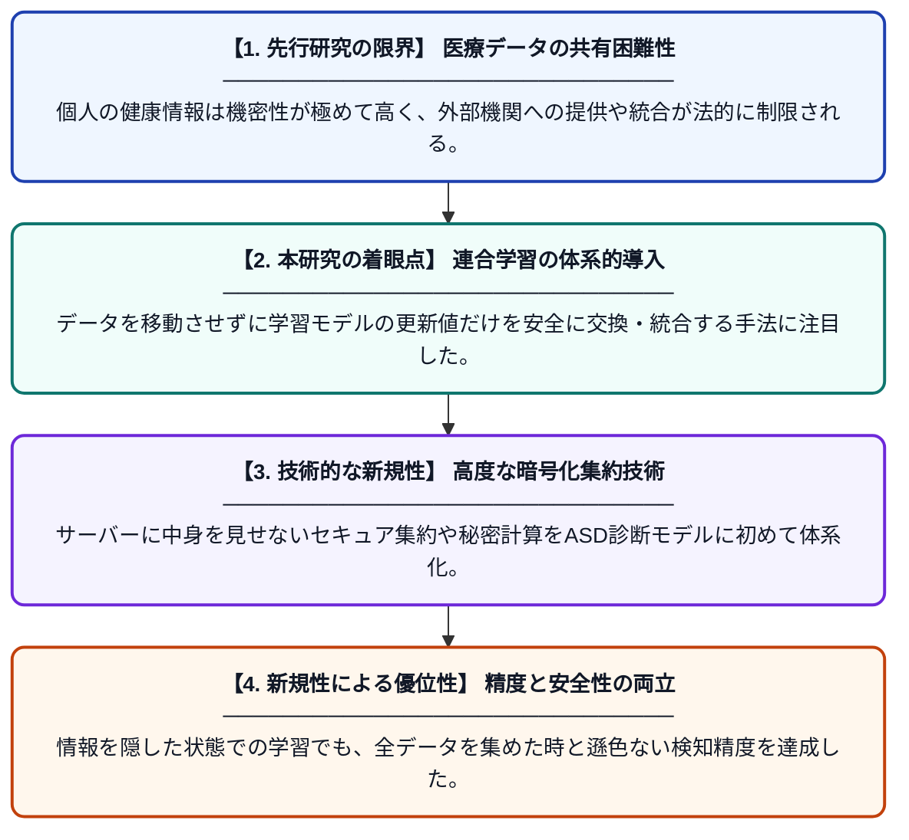

# 共同的な自閉スペクトラム症検知のためのプライバシー保護機械学習：連合学習とセキュアデータ分析に関する系統的レビュー

**Original Title**: *Privacy-Preserving Machine Learning for Collaborative Autism Spectrum Disorder Detection: A Systematic Review of Federated Learning and Secure Data Analytics*

> **💡 一言要約**: プライバシーを守りつつ自閉症を共同で早期発見する

| 項目 | 内容 |
|---|---|
| **著者** | R Feldman, LB Simmons |
| **アラートキーワード** | Secure Computing |
| **PDF** | [https://www.researchgate.net/profile/Arina-Finnegan-2/publication/417624753_Privacy-Preserving_Machine_Learning_for_Collaborative_Autism_Spectrum_Disorder_Detection_A_Systematic_Review_of_Federated_Learning_and_Secure_Data_Analytics/links/6af060c4932f6e4d6a191a3b/Privacy-Preserving-Machine-Learning-for-Collaborative-Autism-Spectrum-Disorder-Detection-A-Systematic-Review-of-Federated-Learning-and-Secure-Data-Analytics.pdf](https://www.researchgate.net/profile/Arina-Finnegan-2/publication/417624753_Privacy-Preserving_Machine_Learning_for_Collaborative_Autism_Spectrum_Disorder_Detection_A_Systematic_Review_of_Federated_Learning_and_Secure_Data_Analytics/links/6af060c4932f6e4d6a191a3b/Privacy-Preserving-Machine-Learning-for-Collaborative-Autism-Spectrum-Disorder-Detection-A-Systematic-Review-of-Federated-Learning-and-Secure-Data-Analytics.pdf) |
| **原文リンク** | [https://www.researchgate.net/profile/Arina-Finnegan-2/publication/417624753_Privacy-Preserving_Machine_Learning_for_Collaborative_Autism_Spectrum_Disorder_Detection_A_Systematic_Review_of_Federated_Learning_and_Secure_Data_Analytics/links/6af060c4932f6e4d6a191a3b/Privacy-Preserving-Machine-Learning-for-Collaborative-Autism-Spectrum-Disorder-Detection-A-Systematic-Review-of-Federated-Learning-and-Secure-Data-Analytics.pdf](https://www.researchgate.net/profile/Arina-Finnegan-2/publication/417624753_Privacy-Preserving_Machine_Learning_for_Collaborative_Autism_Spectrum_Disorder_Detection_A_Systematic_Review_of_Federated_Learning_and_Secure_Data_Analytics/links/6af060c4932f6e4d6a191a3b/Privacy-Preserving-Machine-Learning-for-Collaborative-Autism-Spectrum-Disorder-Detection-A-Systematic-Review-of-Federated-Learning-and-Secure-Data-Analytics.pdf) |
| **PDF版要約** | [README.pdf](./README.pdf) |

---

## 📊 新規性の図解（先行研究との違いと本研究のブレークスルー）

## 📝 要約

自閉スペクトラム症（ASD）の早期検知に向けて、個人情報を保護しながら複数機関で協力してAIを学習させる手法を体系的に調査した論文です。連合学習やセキュアなデータ集約技術を用いることで、プライバシーを厳重に守りつつ、データを1箇所に集めた場合と同等の検知精度を達成できることを示しています。

## ❓ どんな問題に取り組んだか

ASD検知のAI精度向上には大量の医療データが必要ですが、患者のプライバシー保護の観点から施設間でのデータ共有が困難という課題がありました。従来の集中管理型学習では情報漏洩のリスクが高く、安全に共同研究を行うための技術的枠組みが求められていました。

## ✨ 何が新しい？何がすごい？（新規性）

本論文は、ASD検知分野における連合学習（FL）とセキュア計算の最新動向を網羅的にレビューし、技術的な成熟度を明らかにしました。特に、サーバーが個別のデータ更新内容を閲覧できない「セキュア集約」や暗号化技術を導入しても、従来の学習手法と遜色ない診断精度を維持できることを具体的に示した点が大きな貢献です。これにより、プライバシー保護と高精度な診断の両立が理論だけでなく実践可能であることを証明しました。

## 🎓 大学1年生向けの解説

自閉症（ASD）を早く見つけるためには、たくさんの人のデータをAIに学習させて賢くする必要があります。しかし、病気のデータはとても大切な個人情報なので、病院の外に持ち出すのは難しいという問題がありました。そこで「データはその場に置いたまま、AIが学んだ知識だけを共有する」という連合学習という技術が注目されています。この研究は、その最新技術を使えば、秘密をしっかり守りながらも、みんなのデータを合わせたときと同じくらい正確に診断できることを明らかにしました。
