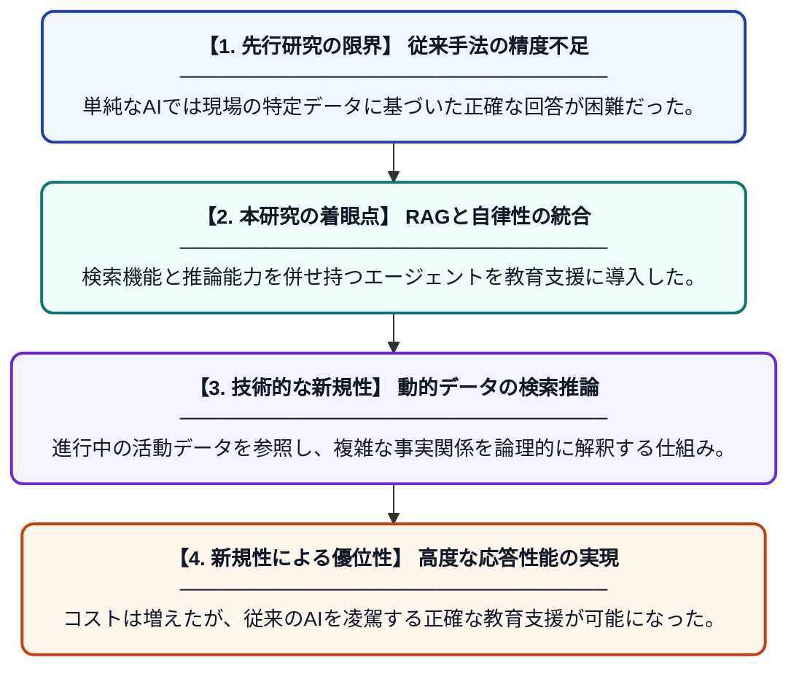

# 低リソース環境の読書クラブ向け検索拡張型エージェントアシスタント：モザンビークにおける実装と比較評価

**Original Title**: *Retrieval-augmented agentic assistant for a low-resource reading club-design: Implementation and comparative evaluation in the Mozambican context*

> **💡 一言要約**: モザンビークの教育を救うAI読書アシスタント

| 項目 | 内容 |
|---|---|
| **著者** | KM Aly |
| **掲載誌** | 2026 |
| **アラートキーワード** | one shot |
| **PDF** | [https://run.unl.pt/bitstreams/ec0783c7-432c-4c8d-8157-6f31103eb678/download](https://run.unl.pt/bitstreams/ec0783c7-432c-4c8d-8157-6f31103eb678/download) |
| **原文リンク** | [https://run.unl.pt/bitstreams/ec0783c7-432c-4c8d-8157-6f31103eb678/download](https://run.unl.pt/bitstreams/ec0783c7-432c-4c8d-8157-6f31103eb678/download) |
| **PDF版要約** | [README.pdf](./README.pdf) |

---

## 📊 新規性の図解（先行研究との違いと本研究のブレークスルー）

## 📝 要約

モザンビークの読書クラブを支援するため、RAG（検索拡張生成）を活用したAIエージェントを開発し、その性能を検証した研究です。従来の手法や人間のメンターと比較した結果、運用コストは高いものの、実際のプログラムに基づいた推論や事実確認において高い精度を示しました。

## ❓ どんな問題に取り組んだか

教育資源が乏しい地域では、適切な教材の提供や学習者の疑問に答える指導者が不足しています。従来の単純なAIでは、特定の教育プログラムの内容に基づいた正確な回答や、文脈を汲み取った高度な推論を行うことが困難でした。

## ✨ 何が新しい？何がすごい？（新規性）

本研究は、低リソース環境という制約下で、RAGと自律型エージェントを組み合わせた「Agentic Assistant」の実用性を実証した点が画期的です。単なる一問一答ではなく、進行中のプログラムデータをリアルタイムで参照し、複雑な推論を伴う21の事実確認要求に対応できることを示しました。また、人間のメンターを用いたブラインドテストにより、その実効性を厳密に評価しています。

## 🎓 大学1年生向けの解説

開発途上国のように先生や本が足りない場所で、AIを使って子供たちの読書を助ける仕組みを作った研究です。インターネットから情報を探してくる機能と、自分で考えて判断する機能を備えた「賢いAIの助手」を構築しました。実験の結果、このAIは普通に質問するだけのAIよりも、実際の活動内容に合わせた正確な答えを出すことができました。これは、技術の力で教育の格差をなくすための重要な一歩です。
